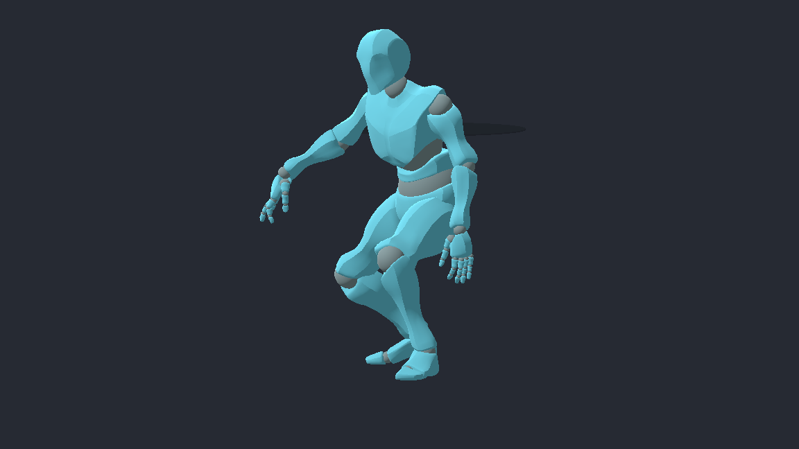
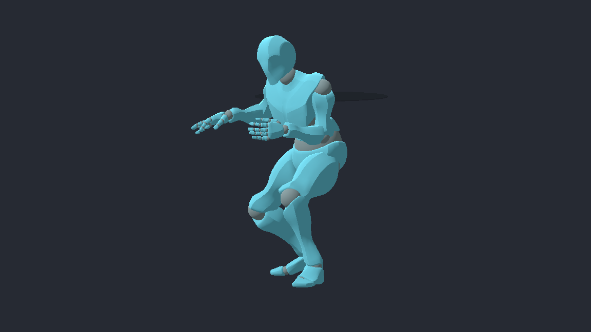
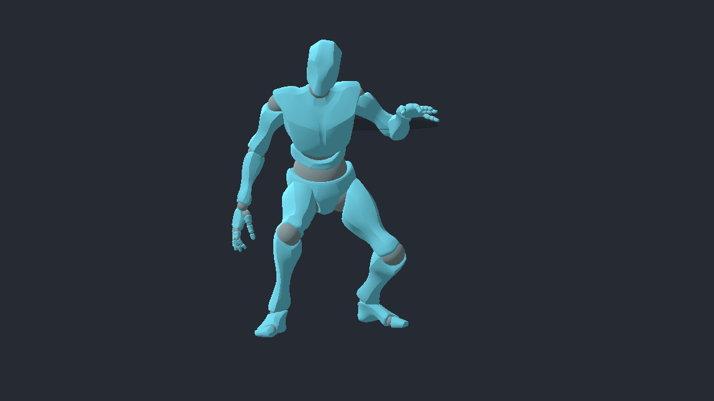
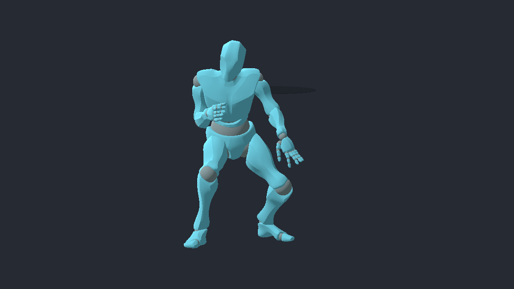

# Ball-protection posture proof

- Issue: [#345](https://github.com/JoseTomanan/hooper-game/issues/345)
- Decisions: ADR-0003 and ADR-0018, amendments dated 2026-10-11
- Date: 2026-10-11
- Baseline: `9cebd768d24c33dba619883f9e45b19f8b418666`

This records state, movement, network and pose evidence for held protection.
The human owns feel in #173 and tuning in #238. These measurements do not
accept those judgments or implement the downstream stance/post-play issues.

## Method and preconditions

The fixtures instantiate the shipped `Player.tscn` and exercise production
`PlayerController` movement/input, `BallController` steal resolution, and the
prediction buffer. Matched steal controls use the same phase and hand; the
wrong-hand control uses a phase inside the protected band. The dead-Held case
enters through a real pump fake before exercising static exposure.

The network fixture uses loopback ENet with separate server, owner and observer
multiplayer scopes. Its correction reference starts from an imposed authoritative
position, velocity and heading and steps an independent scripted input history.
It does not derive expected protection flags from the production buffer.

The measurements depend on Godot `4.7.1.stable.mono.official.a13da4feb`,
60 physics ticks/second, neutral speed 6 m/s,
protection speed 1 m/s, neutral exposure `[0.35, 0.65]`, and protected exposure
`[0.45, 0.55]`. Changing these inputs invalidates the corresponding numbers.
Entry and exit retain the existing finite acceleration path.

## Validation

Both ordinary (`IncludeIntegrationHarness=false`) and proof-enabled (`true`)
Debug builds succeed with zero warnings/errors. The explicit unit-test project
reports 1,176 passed, zero failed, and five existing shot-scatter characterization
skips. All 61 repository contract tests pass. The nine new engine catalog cases
pass with native exit code zero, including the final corrected elbow geometry.

```powershell
dotnet build "HOOPER GAME.csproj" --no-restore -p:IncludeIntegrationHarness=false
dotnet build "HOOPER GAME.csproj" --no-restore -p:IncludeIntegrationHarness=true
dotnet test tests/Hooper.Ball.Tests/Hooper.Ball.Tests.csproj --no-restore
python -m unittest discover -s tests/repository
```

On this Windows host, repository tests require Git Bash ahead of WSL on `PATH`
and workspace-local `TMP`/`TEMP`; the unrestricted subprocess run avoids the
sandbox's Python temporary-child ACL failure. The empty root `dotnet test`
command is not used as suite evidence. Proof builds restore the runtime DLL
after ordinary compilation before any engine scenario runs.

The complete authoritative catalog passes **348/348** cases with native
overall exit code zero. The parent independently checked exact ordered catalog
ID coverage, uniqueness, every native case exit, and the terminal summary.
[Durable per-case results](0345-ball-protection-results.json) are derived from
`.godot/345-full-catalog.log`; raw/native logs remain local under
`.godot/harness-runs/issue345-full/` and each multi-process adapter's artifact path.

```powershell
python tools/harness_catalog.py run --all --run-id issue345-full --godot $taskGodot --bash "C:/Program Files/Git/bin/bash.exe"
```

After the complete sweep, an assertion-only preflight was added to pin protection
speed on the shipped Player scene and both exposure defaults on the shipped Ball
scene. All eight affected local cases pass after a fresh proof build. Production
code is unchanged; the durable full-run results name the original three commits
explicitly rather than attributing that run to the later assertion change.

Independent review of the three implementation/config/test commits found no
high-confidence introduced correctness defects. An earlier adversarial pass
identified the remote baseline self-comparison; it was corrected and its
restoration assertion was discriminated by the remote-leak mutation before
the final review. The parent re-read the assertions and native failure logs.
The late scene-default preflight also received an independent clean review.

## Source verification

Context7 was unavailable in this session. Version-specific official Godot
documentation, followed by the pinned 4.7.1 Mono build and runtime, grounds
the engine calls:

- [InputMap event inspection](https://docs.godotengine.org/en/4.7/classes/class_inputmap.html#class-inputmap-method-action-get-events)
- [SkeletonModifier3D processing and pose restoration](https://docs.godotengine.org/en/4.7/classes/class_skeletonmodifier3d.html)
- [High-level multiplayer RPCs](https://docs.godotengine.org/en/4.7/tutorials/networking/high_level_multiplayer.html#remote-procedure-calls)
- [Per-subtree multiplayer scopes](https://docs.godotengine.org/en/4.7/classes/class_scenetree.html#class-scenetree-method-set-multiplayer)

The reference-grounded choice is tier 2 real basketball: [Jr. NBA dribbling
instruction](https://jr.nba.com/how-to-dribble-a-basketball/) describes using
the body and non-dribbling arm to shield the ball. Narrower exposure is the
single gameplay benefit; the visible arm does not change collision or hand state.

## Discriminating controls

The phase-0.40 matched control first failed with a real steal/Loose turnover
before the protected band was implemented. Afterward, neutral succeeds and
protected misses. Phase 0.50 still succeeds while protected, and targeting the
opposite hand at that same phase still misses. A real pump-fake transition to
dead Held remains vulnerable to the production static-exposure path.

The network reference uses twelve pending rightward samples: four protected,
four released, then four raw protection requests made ineligible by possession
loss. At correction time current protection is false. The intact implementation
matches the independently stepped reference with zero position, velocity and
heading error (tolerance `0.0001`).

Temporary mutations were rebuilt and run against the real ENet fixture:

| Mutation | Observed failure |
|---|---|
| Ignore the recorded effective protection bit during replay | Position error `0.20967734` m; velocity error `0.29058385` m/s |
| Recompute replay protection from current eligibility | The same independent-reference mismatch |
| Keep the remote shield active after server refusal | Remote authored-pose restoration assertion fails |

The remote neutral baseline is captured once during an explicit neutral startup
after the authored pose has settled. It is frozen before protection begins;
refusal compares against that independent baseline. Local checks also require
both handed variants, no cumulative offset, clean release, suppression during
commitment/pivot, and resumption afterward. These test modifier precedence over
a controlled authored pose, rather than judging commitment clip quality.

Rendered inspection exposed a hanging-arm offset that passed quaternion-delta
checks. A new independent forward-kinematics assertion failed that version:
off-hand world Y was `-0.33053213`, below its neutral value `-0.2866286`, with
hips Y `-0.037080646` and head-to-toe height `1.1602405` m. The corrected elbow
bend passes both handed variants: the guard hand must reach at least hips Y
minus 10% of rig height and rise at least 10% of rig height above neutral.
This assertion pins the named shield geometry without accepting human feel.

## Rendered companion

The render-only `capture-dribble` companion selects animation through production
`ApplyAnimation`, advances the real AnimationTree, and requires the observed
state to be `DribbleRight` or `DribbleLeft` before capture. It exits zero after
saving four images. The fixture freezes ball simulation and omits its visual
mesh; these images demonstrate the player overlay rather than ball-hand sync.

| Hand | Neutral | Protected |
|---|---|---|
| Right |  |  |
| Left |  |  |

Frames advance normally, so the ball arm can be at different dribble phases
between images. Its unchanged local rotation is proven against the same
underlying authored pose in the separate assertion fixture. The parent inspected
all four images: the off-arm is raised and bent across the guard side, and the
named posture is visible. This does not accept competitive legibility or feel.

Reproduction (omit `--headless` to render; the fixture is not the editor):

```powershell
& $taskGodot --path . --log-file .godot/protect-dribble-render.log res://tests/integration/ProtectionTest.tscn -- --harness-scenario=capture-dribble --capture-output=.godot/345-dribble-capture
```

The renderer was Mobile/D3D12 on an NVIDIA RTX 3050. A root-certificate-store
warning and shader-cache write warning appeared; all PNG saves returned `Ok`,
the observed handed states were correct, and the native process exited zero.

## Limits

Reconciliation preserves sampled effective protection for pending neutral
movement. It does not reconstruct historical authoritative possession or
committed-move eligibility. The ENet fixture proves real input/state transport
and a controlled mixed-history correction; it is not an internet-latency sweep
or a lag-compensation proof.

Pose assertions establish a distinct reversible posture on the shipped rig.
Competitive legibility and visual quality remain human judgments in #173.
No editor wiring is required to enable the action.
