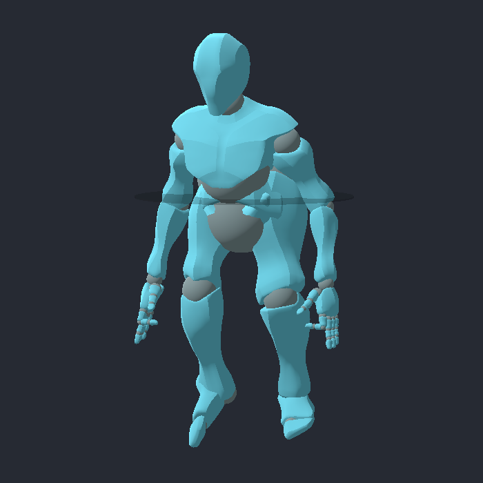
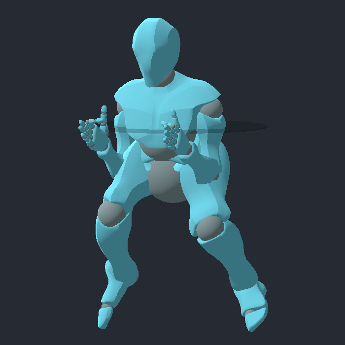

# #346 — Defensive stance proof

- **Issue:** [#346](https://github.com/JoseTomanan/hooper-game/issues/346), approved brief dated 2026-10-11
- **ADRs:** 0003, 0010 (authorized stance amendment), 0018, 0025
- **Date:** 2026-10-11
- **Purpose:** Record state and rendered evidence for the continuous defensive posture. The human owns feel in #173; provisional movement tuning remains in #238. These results do not sign off either.

## Method

`DefensiveStanceTest` loads the shipped player for role, heading, pivot and committed-move checks. It drives the real host or remote-authority tick with the existing `move_protect` request. Paired response measurements call production `Move` on identical code-built capsules, with a distant explicit opponent sample and identical initial velocities. Their headings already face the requested reversal, deliberately isolating acceleration from ordinary pivot cost. Contact scenarios drive production paired contact with a real stance request; a collision-layer-zero pair is the discovery-disabled control.

`NetDefensiveStanceTest` starts a dedicated authority with no player 1 and two genuine clients. Requests pass through production `SubmitInput`; acknowledgements and effective posture pass through `ReceiveState`. The defender holds posture and sprint, while the observing client leaves both released. Possession changes from attacker to defender, to Loose, and back without releasing/rearming posture. A displaced predicted body must receive a physical wire correction. Both input streams must advance their sequence acknowledgements.

The replay phase pauses server stepping, drains already-sent state, and records twelve real client predictions: four held/eligible ticks, four released ticks, then four held/ineligible ticks. A forced authoritative correction replays the pending buffer. An independent reference supplies that schedule explicitly, without reading buffer flags. Both use the same stationary latest raw opponent sample. The opponent's cosmetic position and heading are deliberately far from that raw sample. Position, velocity and heading must agree within 0.0001 after replay.

`run_net_defensive_stance.py` puts a UDP relay on each client link. Monotonic timestamps measure dwell separately in all four directions; every direction must carry traffic and its minimum dwell must meet the requested delay. Baseline and 30 ms per direction run as separate catalog cases. This is transport delay, not a harness-only tick sleep.

`DefensiveStancePresentationTest` observes the shipped skeleton inside `SkeletonModifier3D.ModificationProcessed`. Paired comparisons use the same authored animation time. It checks lower hips/head, wider bilateral feet, raised hands, bent knees, finite rotations, repeated-frame stability and restoration on release. Steal/Block/Contest and owed pivots bypass the modifier. Remote presentation uses the production snapshot receiver and remote tick under a client role; genuine snapshot transport is separately proven by the network test. Capture mode runs production animation selection and asserts its selected states.

The modifier follows the official [Godot 4.7 SkeletonModifier3D lifecycle](https://docs.godotengine.org/en/4.7/classes/class_skeletonmodifier3d.html), applying an overlay to the fresh authored pose after animation. Character-space leg rotations account for parent transforms using the documented [Skeleton3D pose API](https://docs.godotengine.org/en/4.7/classes/class_skeleton3d.html).

## Constants and measurements

The shipped scene has no override of these stance exports. The `gates` scenario asserts their values against the unchanged neutral defaults.

| Axis | Stance | Neutral |
|---|---:|---:|
| Speed, m/s | 3 | 6 |
| Acceleration, m/s² | 60 | 45 |
| Stopping rate, m/s² | 90 | 70 |
| Maximum heading rate, degrees/s | 360 | 900 |

At 60 Hz, paired response controls measured:

| Measurement | Stance | Neutral |
|---|---:|---:|
| Accelerate from rest beyond 2.25001 m/s | 3 ticks | 4 ticks |
| Stop from 2.4 m/s below 0.001 m/s | 2 ticks | 3 ticks |
| Reverse from +2.4 beyond −2.25001 m/s | 5 ticks | 7 ticks |
| Coverage from rest over 60 ticks | 2.9499984 m | 5.6500206 m |

Entry from 6 m/s preserves finite momentum, reaching 5 m/s after one stance tick; exit from 3 m/s reaches 3.75 m/s after one neutral tick. No instant velocity cap or reset is used. Heading checks cover idle turning, lateral movement, moving targets, wraparound and coincidence. Existing owed pivots resolve their original target before stance takeover. Paired Steal/Block/Contest checks observe Startup, Active and Recovery and compare timeline, heading and displacement to an unheld control.

Slow facing stance denies a drive without displacing the set defender. A fast sliding stance remains unset and shares the contact impulse. Both show a positive effect against their disabled-contact pair. No contact predicate, leverage, defensive success window, shot accuracy or rebound rule changes.

Three baseline and three delayed network trials passed. Across the delayed trials, minimum measured dwell was at least 30.0141 ms in every direction; direction means ranged from 32.45 to 34.17 ms. All six independent twelve-tick replay comparisons produced zero position, velocity and heading error. A trailing ordinary movement segment can remove velocity/heading differences while leaving a positional difference, so the replay assertion checks all three.

## Rendered evidence

These 700×700 captures use the production Mobile/D3D12 renderer and real animation selection. The fixture has no court floor; use it to inspect relative body posture and clip precedence, not grounding or gameplay feel. The committed captures hold their actual startup phase to expose the authored pose.

| Neutral authored locomotion | Effective stance overlay |
|---|---|
|  |  |

[Steal startup](0346-evidence/production-steal.png), [Block startup](0346-evidence/production-block.png), and [Contest startup](0346-evidence/production-contest.png) select `StealStartupRight`, `BlockStartup`, and `ContestStartup` respectively, with stance false. The pose test separately proves modifier bypass using identical authored frames; these captures show production state selection.

## Reproduction

```powershell
dotnet build 'HOOPER GAME.csproj' --configuration Debug -p:IncludeIntegrationHarness=true
dotnet test tests/Hooper.Ball.Tests/Hooper.Ball.Tests.csproj --configuration Debug
python tools/harness_catalog.py run --scene DefensiveStanceTest.tscn --scene DefensiveStancePresentationTest.tscn --godot <Godot-4.7.1-Mono-console>
python tests/integration/run_net_defensive_stance.py --godot <Godot-4.7.1-Mono-console> --all --repeat 3 --output .godot/stance-net/repeated-proof
python tools/harness_catalog.py run --all --godot <Godot-4.7.1-Mono-console> --bash <Git-Bash>
```

For rendered evidence, launch `res://tests/integration/DefensiveStancePresentationTest.tscn` as a windowed game with `--log-file .godot/stance-capture.log`, then user arguments `--harness-scenario=capture --capture-output=.godot/stance-capture`. The catalog injects unique workspace-local native logs for its direct invocations; the network adapter does likewise for every peer.

## Limits

All replayed ticks use the latest available raw opponent snapshot, as accepted under ADR-0025/#370. Exact moving-opponent history is not stored or claimed. Existing committed-motion replay limitations remain; no stale authoritative frame counter is force-matched. The local and remote skeleton checks prove observable posture and precedence; they do not accept feel or visual quality. No editor setup is required: hold Ctrl/left trigger as the defender of a live holder and slide with the normal movement input.
