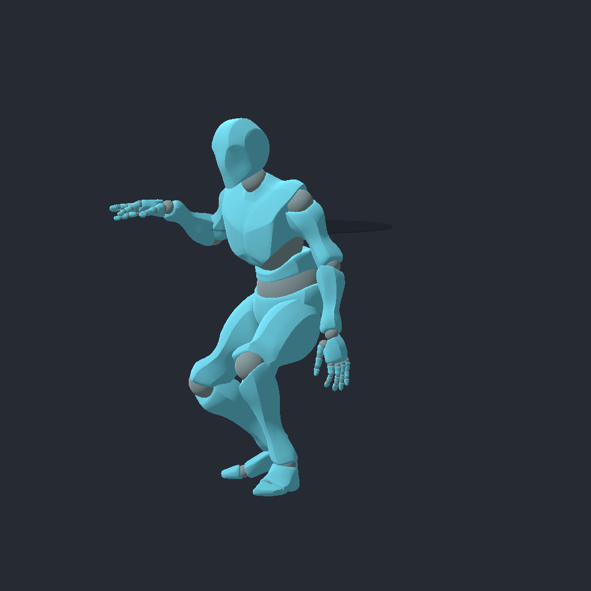
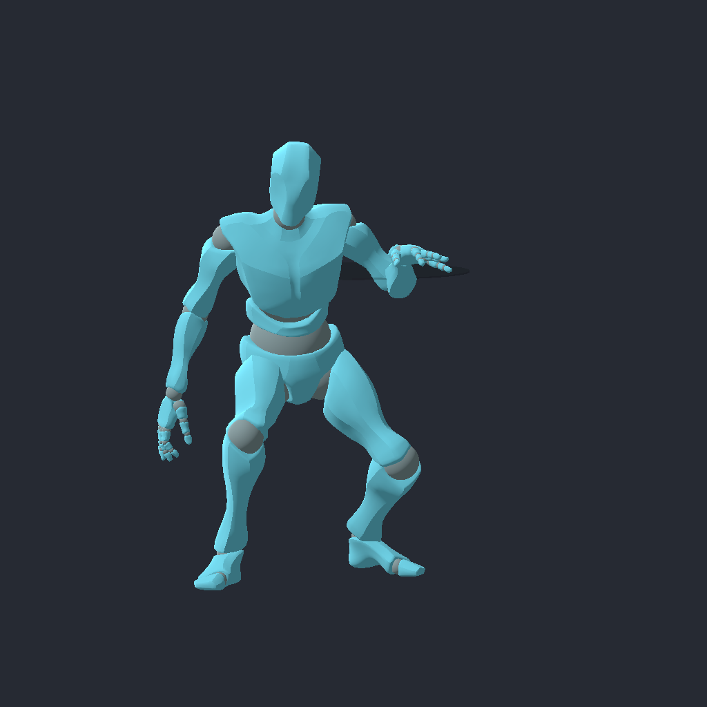
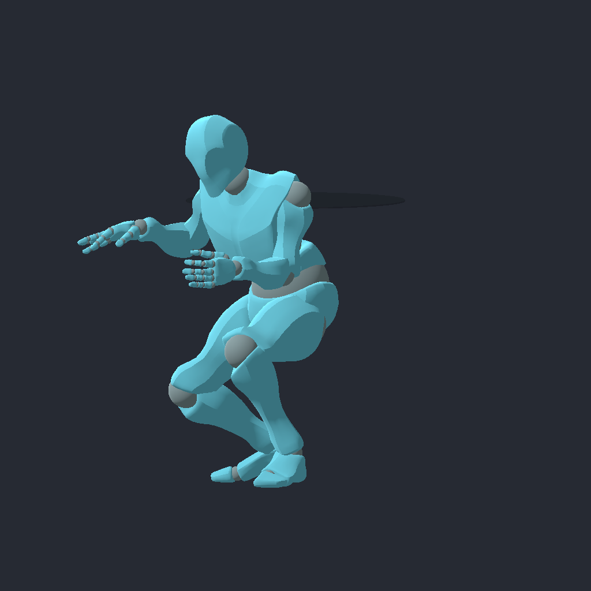
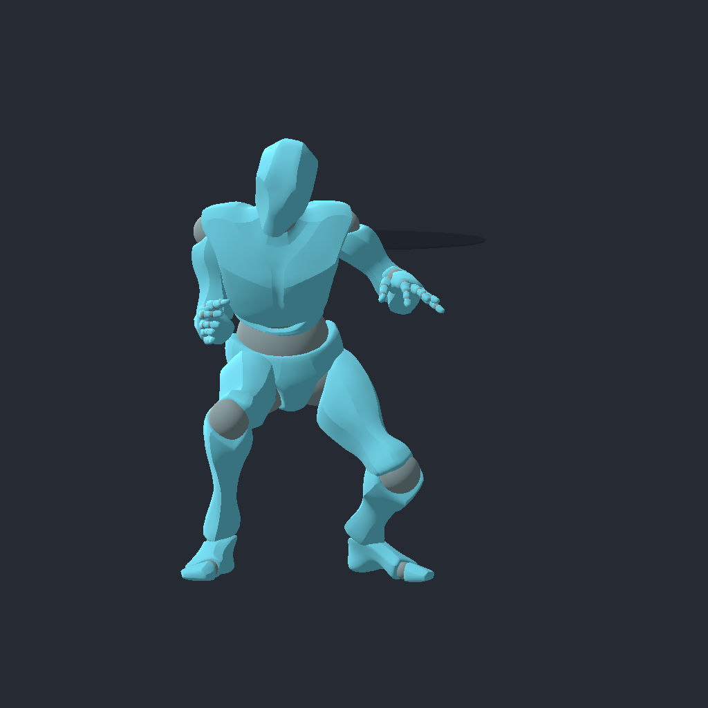
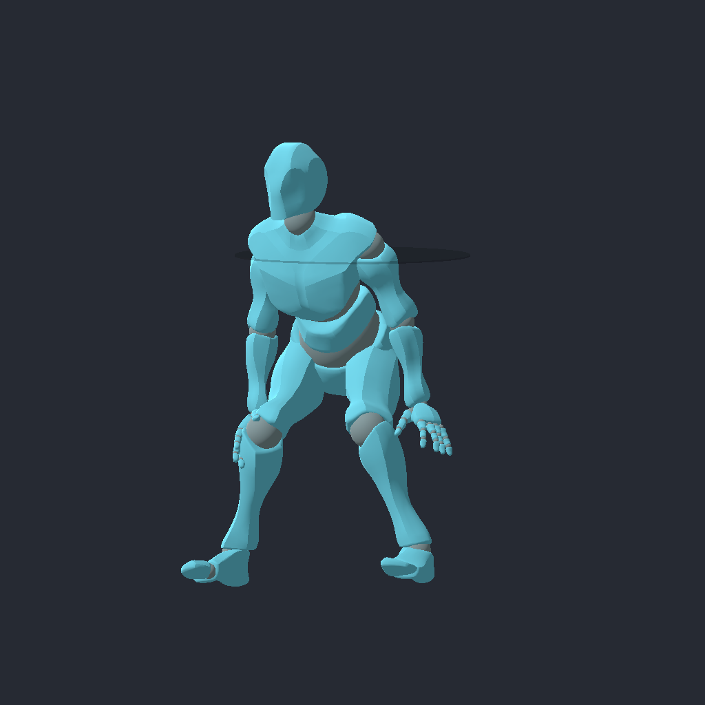
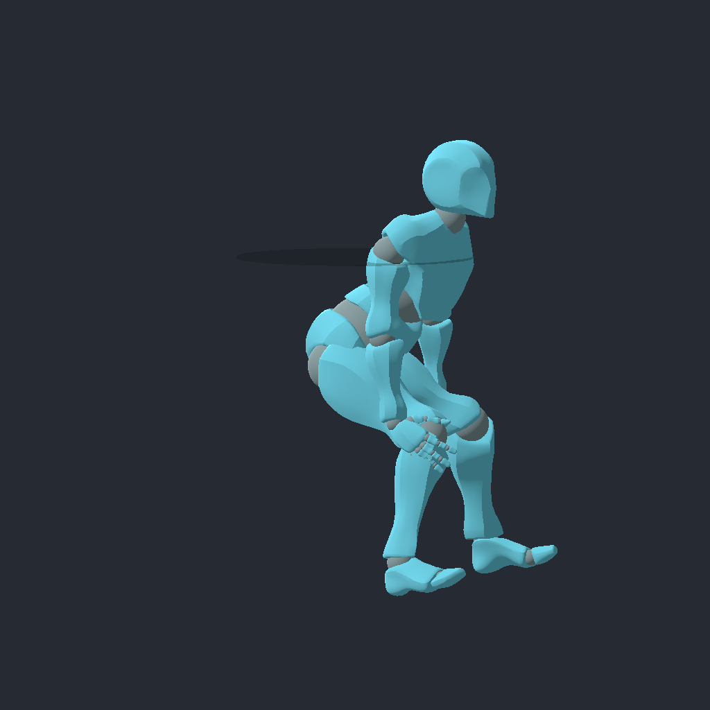
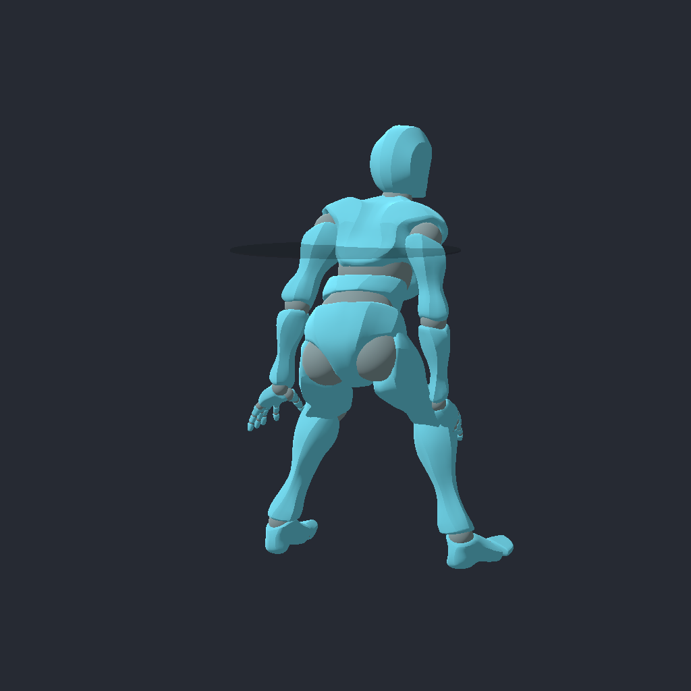
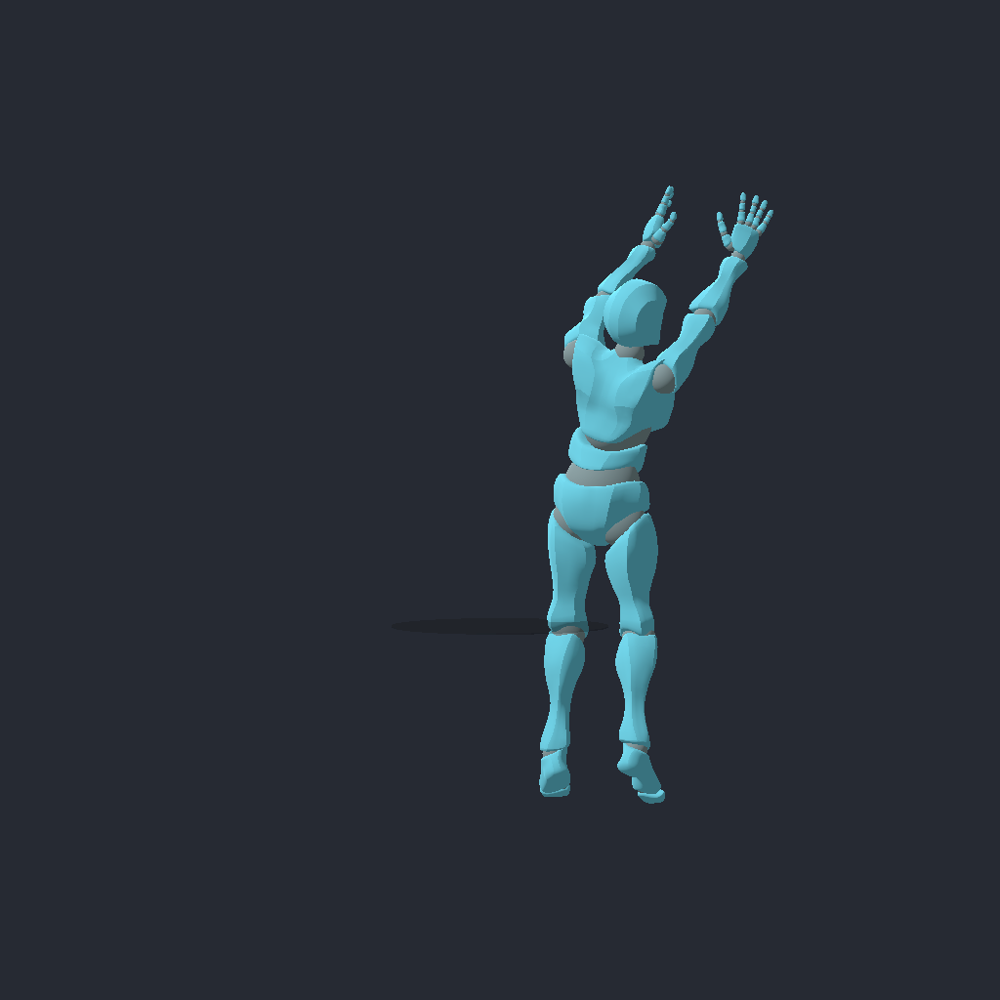
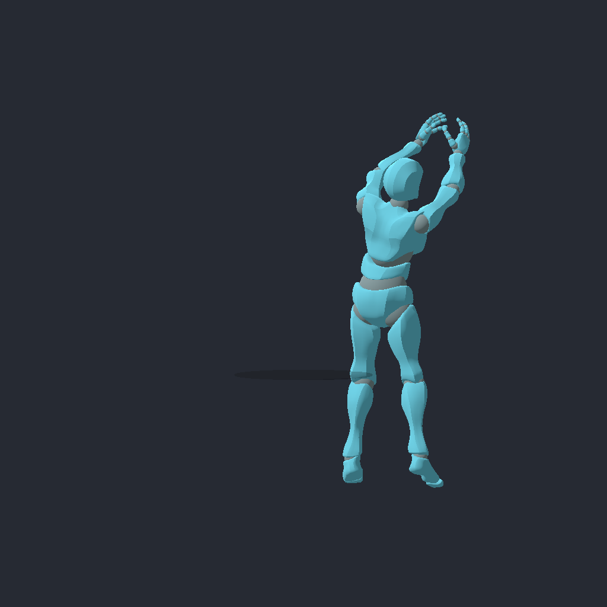

# First post-play slice: measured proof

- Issue: [#348](https://github.com/JoseTomanan/hooper-game/issues/348)
- Measurement date: 2026-10-12
- Authority: ADR-0002/0003/0008/0009/0010/0012/0023/0025/0026
- Discipline: test-driven development and source-driven development, with independent authoritative-state review
- Scope: held post entry/exit, slow world-space movement, one committed turnaround shot, historical replay and remote presentation

This records implementation evidence, not tuning advice or feel acceptance.
The approved issue brief authorizes the narrow ADR-0010 facing exception;
[ADR-0026](../adr/0026-first-post-play-slice.md) records its contract.
Protection #345 and production contact #370 were closed at pickup. M11 remains
on hold, and the umbrella #355 and contact parent #347 are separate work.

## Implementation and official sources

Holding T or D-pad Down requests post while a live holder is Dribbling and
outside a committed move. Authority derives eligibility each tick. Existing
pivot debt completes before entry turns away from the rim; commanded movement
waits until entry is established, while momentum brakes finitely. The stick
retains world-space movement. Post takes precedence over protection and sprint.

A fresh shoot edge after entry requests `turnaround`. Authority snapshots its
own rim-facing target at accepted Begin. The committed move turns during
Startup, cradles once, releases once at the first Active tick, and runs its
whole timeline even if a steal or OOB removes the ball payload. Accuracy and
contact retain their existing production paths. Existing explicit JumpShot and
Layup requests retain their admission contracts and actual-heading penalties;
invalid turnaround requests never fall back to those identities.

| Official engine contract | Application |
|---|---|
| [Input polling and synthetic events](https://docs.godotengine.org/en/4.7/classes/class_input.html) and [InputMap events](https://docs.godotengine.org/en/4.7/classes/class_inputmap.html#class-inputmap-method-action-get-events) | Sample the held request before the shoot edge; prove the actual physical-key and joypad bindings with parsed press/release events |
| [RPC declarations and paths](https://docs.godotengine.org/en/4.7/tutorials/networking/high_level_multiplayer.html#remote-procedure-calls) | Send explicit trailing wire arguments, correlate turnaround targets by Begin sequence token, and exercise real dedicated-server client owners |
| [SkeletonModifier3D processing](https://docs.godotengine.org/en/4.7/classes/class_skeletonmodifier3d.html) | Apply a presentation-only post pose after protection; committed moves and ordinary pivots take precedence |
| [Animation tracks and lengths](https://docs.godotengine.org/en/4.7/classes/class_animation.html) | Generate a distinct turnaround library preserving source Active/Recovery rotations and matching the fixed frame windows |
| [Quaternion inverse](https://docs.godotengine.org/en/4.7/classes/class_quaternion.html#class-quaternion-method-inverse) | Normalize imported quaternion samples before measuring rotational deltas; retain the original angular tolerance |

## Preconditions

These measurements depend on the following shipped defaults and fixtures.
Changing them invalidates the corresponding numbers and requires rerunning the
proof. They are provisional implementation values, not endorsed feel tuning.

| Parameter | Value / units |
|---|---|
| Physics frequency | 60 ticks/s |
| `PostSpeed` / neutral `MoveSpeed` | 1.5 / 6 m/s |
| `PostTurnRateDeg` / `TurnaroundTurnRateDeg` | 360 / 360 degrees/s |
| `PostEntryToleranceDeg` | 2 degrees |
| `GatherDecel` | Existing 40 m/s² |
| Entry momentum braking `Decel` | Existing 70 m/s² |
| Turnaround Startup / Active / Recovery | 48 / 4 / 20 ticks; 0.8 / 0.066667 / 0.333333 s |
| Maximum half-turn at turnaround rate | 0.5 s; exact 180-degree tie uses positive yaw |
| Network queue conditions | 0 and 30 ms per direction, on both client links |
| Rig/renderer | Production `Player.tscn`, Godot 4.7.1 Mono, Mobile; native captures use D3D12 |

## Local behavior proof

`PostPlayTest` has 20 catalog scenarios: `entry`, `entry-side`, `entry-away`,
`entry-coincident`, `speed`, `gates`, `bindings`, `pivot`, `dispatch`,
`turnaround`, `accuracy`, `accuracy-unsquared`, `lost-payload`,
`turnaround-steal`, `turnaround-oob`, `replay`, `turnaround-replay`,
`turnaround-rejected`, `contact-set`, and `contact-unset`.

Entry tests cover face-on, side-on, already-away and coincident rim direction.
Matched speed trials use the same heading and zero starting velocity for all
eight stick directions; measured steady speed is 1.5 m/s versus 6 m/s neutral.
Gates include actual dead-Held cradle and live-Held possession reset, Loose,
InFlight and nonholder states. The binding proof parses real T and D-pad Down
InputMap events through `Input.ParseInputEvent` and `FlushBufferedEvents`;
it proves routing, not physical controller hardware.

Pivot toggles retain the owed target and finite braking; the completion tick
cannot double-turn or admit a turnaround. Dispatch tests reject early entry
and nonholder requests, ignore a client-supplied target of 999, and select the
explicit move identity. Fixed-target tests change input and rim after Begin
without retargeting. Successful release count is exactly one, with natural
48/4/20 phase counts. Actual static steal and actual OOB controls void payload
without shortening that same timeline.

Accuracy tests compare the real applied aim target against the first seeded
random draws, measured release position, Begin-speed sample and the existing
four penalty factors. A deliberately unsquared release keeps a facing factor
above 1.5 and catches both a forced facing exemption and a downstream bonus.
This is release/scatter proof, not a measured make percentage.

Forced replay supplies historical post eligibility and rim context while the
current ball is Loose and the current rim differs. Matching-token confirmation
repairs only that turnaround instance's fixed target; future tokens retain
their samples. Confirmed rejection removes historical phantom turn motion
without creating ball events. Production capsule trials compare set/unset
contact with matched disabled-contact controls.

Initial runtime RED logs caught missing bounded entry and missing turnaround
selection before their GREEN implementations. Eleven subsequent production
mutants each built successfully and failed the intended behavior assertion;
source bytes were restored exactly after each run. The complete substitutions,
commands and failure markers are in [local-mutations.json](0348-rendered/local-mutations.json).

| Mutant | Discriminating failure |
|---|---|
| Disabled post / instant entry turn | Entry fails bounded-turn assertion |
| Erased pivot debt | Existing owed pivot target is lost |
| Contact bypass while posting | Motion matches disabled control |
| Early shot fallback | Early entry begins a shot |
| Repeated Active release pulse | Release count becomes 4 |
| Facing factor forced to 1 / downstream post bonus | Real facing term / applied scatter target differs |
| Disabled confirmed-target repair | Buffered target is not instance-correlated |
| Dropped post history | Mixed replay position differs |
| Retained rejected turnaround history | Restored authoritative heading is overwritten |

## Dedicated-server and delayed-network proof

`NetPostPlayTest` uses one dedicated server with no player 1 and two independent
ENet clients. Reliable fixture setup is separate from actual held-input and
move-request RPCs. The server runs the real ball physics release path. The
observer has no local post button held; received effective posture, heading,
move identity and phase drive actual production rig nodes and bone changes.

Both baseline and 30 ms trials exited zero for all three processes. The
retained [network summary](0348-rendered/network-final-green.json) includes
per-direction packet counts and measured dwell, not an assumed delay.

| Measurement | Baseline | 30 ms per direction |
|---|---:|---:|
| Authoritative post ticks / early rejects / nonholder checks | 80 / 19 / 45 | 80 / 19 / 45 |
| Actual shot releases | 1 | 1 |
| Final acknowledged sequence / sent sequence | 849 / 849 | 845 / 845 |
| Observer samples in actual Startup / Active / Recovery nodes | 46 / 4 / 13 | 28 / 3 / 12 |
| Observer post-pose samples | 1432 | 1460 |
| Post hips delta relative to previous modifier callback | -0.060000002 m | -0.060000002 m |
| Independent 24-sample replay position / velocity / heading error | 0 m / 0 m/s / 0 rad | 0 m / 0 m/s / 0 rad |
| Forced correction magnitude / final stationary convergence | 0.92229325 m / true | 0.9013879 m / true |

Observer sample counts are receipt/processing counts, not authoritative phase
durations. All four delayed relay directions forwarded more than 900 packets;
their measured minima were 30.0138–30.0324 ms, means 31.8091–33.1766 ms and
maximum dwell 45.7657 ms.

The independent replay uses 12 held/eligible, 8 released/eligible and 4
held/ineligible historical samples. Current possession contradicts 20 eligible
samples. Dropping buffered post or substituting current eligibility causes
position error 0.6444448 m, velocity error 4.666667 m/s and heading error
0.41050673 rad after the live checks pass. See the two retained mutation
summaries: [drop-post](0348-rendered/network-mutation-drop-post.json) and
[current-eligibility](0348-rendered/network-mutation-current-eligibility.json).

The replay correction uses a synthetic authoritative baseline after real
client prediction samples. This does not claim exact moving-opponent history
or exact replay of stale
remote Startup counters. Latest raw opponent snapshots remain the accepted
contact approximation. Local forced turnaround replay covers token/target
repair; the network trial covers actual wire, authoritative gates, release,
observer presentation and controlled post-history replay. The relay trials
characterize delay, without injecting packet loss.

## Presentation and rendered evidence

`PostPresentationTest` loads the actual rig and proves both handed poses,
neutral/protection distinction, no accumulation, restoration on release,
ordinary pivot precedence and committed-move precedence. It validates 53
Startup tracks including 52 authored rotation tracks, source Active/Recovery
rotation samples (tolerance 0.0001 rad), and fixed phase lengths (0.001 s).
Synthetic remote-selector fixtures supplement the separate real network proof.

Five presentation mutants fail the intended assertions: disabled post,
missing committed-phase gate, missing left-leg bend, missing material rotation
track and a one-tick animation length drift. See
[presentation-mutations.json](0348-rendered/presentation-mutations.json).
The first missing-phase-gate mutation survived an inadequate zero-influence
control: `ModificationProcessed` still exposed the raw callback's writes.
The corrected control sets the modifier's player to null to make a true
no-write baseline, then restores its player for treatment. The mutant now
fails on overwritten actual turnaround Startup pose. This discovery changed
the assertion control, not gameplay or tolerance.

Nine native 1024×1024 images show fixed presentation fixtures through the
production rig and AnimationTree. [manifest.json](0348-rendered/manifest.json)
retains capture source commit `46f1088deaaf0516b5adaec4710322d71fe4e775` in the
isolated presentation branch; its final proof-control patch was cherry-picked
here as `34a0de9`. The artifact source code/asset changes are equivalent;
the original provenance has not been rewritten. Full-bone camera bounds
include raised fingers. These fixtures omit live ball/defender gameplay and
are neither transport proof nor human acceptance of animation quality.

| Right-hand comparison | Left-hand comparison |
|---|---|
|  |  |
|  |  |

| Turnaround sample | Render |
|---|---|
| Entry |  |
| Turn |  |
| Windup |  |
| Release |  |
| Recovery |  |

## Reproduction and regression gates

From the repository root, using a Godot 4.7.1 Mono executable:

```powershell
dotnet build "HOOPER GAME.csproj" --configuration Debug -p:IncludeIntegrationHarness=true
dotnet test "tests/Hooper.Ball.Tests/Hooper.Ball.Tests.csproj" --configuration Debug
python -m unittest discover -s tests/repository -p 'test_*.py' -v
python tools/harness_catalog.py run --all --godot "$env:GODOT"
```

On Windows, put Git Bash before the Windows WSL `bash` shim in PATH and set
`PYTHON` to the actual Python executable for multiprocess adapters. Catalog
launches inject unique workspace-local Godot logs. Focused selectors and paired
controls can be audited with `python tools/harness_catalog.py list --scene
PostPlayTest.tscn` and the analogous presentation/network scene selectors.
The direct network runner also reproduces both conditions:

```powershell
python tests/integration/run_net_post_play.py --godot "$env:GODOT" --all --output .godot/348-reproduce-net
python tests/integration/run_net_post_play.py --godot "$env:GODOT" --delay-ms 30 --mutation drop-post --output .godot/348-reproduce-drop
python tests/integration/run_net_post_play.py --godot "$env:GODOT" --delay-ms 30 --mutation current-eligibility --output .godot/348-reproduce-current
```

The latter two commands should exit nonzero at the independent replay
assertion. Presentation capture requires a native renderer, a fresh output
directory and `--harness-scenario capture --capture-output <path>
--capture-commit <source-sha>` on `PostPresentationTest.tscn`, with a unique
workspace `--log-file`.

As of 2026-10-12 the final game build has zero warnings/errors; all 1,200 unit
tests pass with five intentionally skipped characterization tests; all 61
repository contracts pass. Final independent code review of PR #408 at
`cdb676a` found no high-confidence introduced defects across authoritative
behavior, presentation, guidance, adapters, catalog and evidence.

[CI run 38238887592](https://github.com/JoseTomanan/hooper-game/actions/runs/38238887592)
at `cdb676a` passed every check, including ordinary game compilation without
integration sources, rendered-evidence capture, and all 384 catalog cases.
The four exhaustive shard summaries were 89/89, 88/88, 108/108 and 99/99;
their required `integration-test` aggregate passed.

The additional serial Windows run retained `.godot/348-regression-harness.log`
and exited 1 at **383/384**. Every new post case passed. Its only failure was
`net-rig-presentation-left`: the connected/ready client timed out at stage 0
without observing matching Startup, then ended at Inactive/Locomotion. The
paired right-hand case passed. No bone-default mismatch or RPC error was
reported. This failure has not established a causal defect in post play;
scheduling/receipt of the short sequence is a hypothesis, not a measured cause.
Three subsequent isolated paired repetitions passed **6/6**, each recording
both peer exit codes zero and actual same-tick Startup, Active, Recovery and
Inactive nodes for both hands. Raw logs are
`.godot/348-regression-rig-focused-{1,2,3}.log`; the timeout did not recur.
The original full-sweep result remains 383/384, not a rewritten green run.
No source, assertion or threshold was changed in response to it. A compact
[local regression summary](0348-rendered/local-regression.json) preserves
the failure and all paired rerun markers.

## Scope limits and tuning observations (no prescription)

The evidence establishes state, timing, contact routing, wire transport and
presentation selection within the stated fixtures. It adds no stamina,
strength advantage, new foul rule, back-down guarantee, accuracy bonus or
additional post finish. No editor wiring is required. Tuning belongs to #238,
and feel/animation taste remains for the human-scheduled #173 pass. These
measurements do not recommend particular values or accept those judgments.
