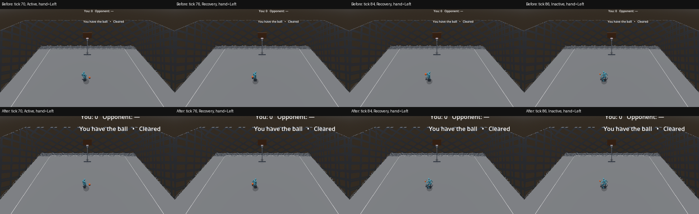
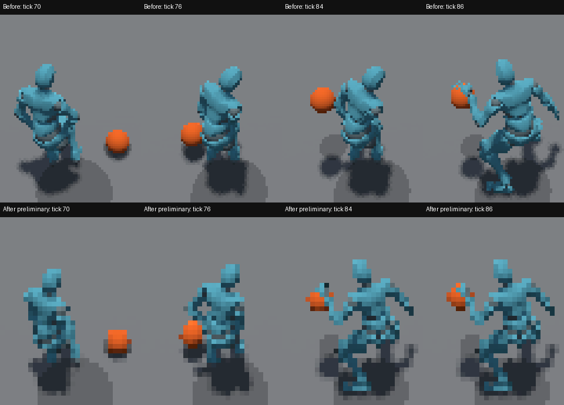

# Crossover hand transfer and body continuity

- Issue: [#414](https://github.com/JoseTomanan/hooper-game/issues/414)
- Baseline production: `f4691d2`; reproduction instrument: `2cb67d8`
- Engine: Godot 4.7.1 Mono; .NET SDK 8.0.421; measurement dates: 2026-10-17–18
- Discipline: source-driven development, diagnosis and doubt-driven review

**Status: endpoint repair and approved coherent remote buffer implemented.**
The final native matrix passes all eighteen captures: eight local, eight
real-time remote and two forced late-Startup/underflow controls. The earlier
valid LAN failure remains below as the evidence that required the buffer.
PR #419 carries the implementation; #414 closes only when that PR merges.

## Reproduction and cause

The production Main scene, player spawner, Player scene, AnimationTree, Ball
and gesture recognizer reproduce the report. No harness begins a committed
move or writes its phase, hand, heading or animation state. The left-origin
fixture first performs a real preparation crossover. Moving entries reach
6 m/s before recognition; movement is released during Recovery. Repeated
cases alternate hands three times with a full neutral dribble between actions.

The fixed-heading right-origin stationary baseline transfers its ball during
ticks 70–76. Its delayed body snap occurs at tick 86, on the first evaluated
destination-neutral pose. The final sampled Recovery pose and neutral pose
differ by 0.609 m at the right wrist and 0.338 m at the right ankle, after
removing root translation and heading. An independent clip sampler reproduces
the captured differences within approximately one micrometre. Left-origin
Recovery-to-neutral also jumps: wrists 0.441/0.579 m and ankles 0.331/0.247 m.
Sampling the exact Recovery endpoint instead of the last ordinary sample does
not remove these mismatches. Neutral-to-Startup endpoints also differ.

The authored Startup/Active and Active/Recovery endpoints already agree.
Origin-hand clip families are intentional; changing them to the current hand
at Active entry would select the wrong physical action. The defect is an
endpoint mismatch plus a one-evaluation state-machine handoff, rather than an
authoritative hand flip or an unexpected heading turn. A second, independent
remote failure is described under Recorded results.





## Repair and official contracts

The per-player `CrossoverPose` modifier samples the original immutable clips.
Startup begins from the last final displayed pose; Active retains its authored
pose; Recovery ends at destination dribble-idle. If possession is already gone
when Recovery begins, it targets idle. The Recovery anchor is frozen for that
phase, so a late possession event cannot replace an almost fully weighted
target. Authoritative state, ball simulation, phase lengths and shared assets are
unchanged. Remote presentation timing follows ADR-0027, described below.

The bridge interpolates skeleton-space global orientations, unwraps quaternion
signs over time, and solves the four two-link limbs toward interpolated wrist
and ankle positions. Local-rotation interpolation was rejected after a scratch
prototype lifted feet by 0.68 m and produced a 0.78 m foot step. Startup body
and arm paths ease smoothly; support-foot targets travel linearly because a
moving entry has only the existing six-frame window to cover their displacement.
Recovery eases to its endpoint inside its existing twelve frames. This does
not add a state-machine crossfade or extend a committed move.

| Documented contract | Use here |
|---|---|
| [SkeletonModifier3D runs after the mixer and restores its input](https://docs.godotengine.org/en/4.7/classes/class_skeletonmodifier3d.html) | Apply a private cosmetic pose without mutating the library or gameplay. |
| [SkeletonUpdated observes the final skeleton](https://docs.godotengine.org/en/4.7/classes/class_skeleton3d.html#class-skeleton3d-signal-skeleton-updated) | Cache the displayed incoming pose and synchronize final bone snapshots. |
| [Animation rotation and position interpolation](https://docs.godotengine.org/en/4.7/classes/class_animation.html#class-animation-method-rotation-track-interpolate) | Sample the authored phase using the local machine counter or buffered server counter; retain actual rig scale. |
| [Quaternion Slerpni and arc constructor](https://docs.godotengine.org/en/4.7/classes/class_quaternion.html) | Keep a consistent temporal hemisphere and solve limb rotations. |
| [AnimationMixer.Advance(0)](https://docs.godotengine.org/en/4.7/classes/class_animationmixer.html#class-animationmixer-method-advance) | Evaluate a crossover boundary immediately without advancing its clock. |
| [Playback travel and current position](https://docs.godotengine.org/en/4.7/classes/class_animationnodestatemachineplayback.html) | Record state/time separately from the actual final evaluated pose. |
| [Input.ActionPress](https://docs.godotengine.org/en/4.7/classes/class_input.html#class-input-method-action-press) | Exercise production input polling and gesture recognition. |
| [Fixed-fps disables real-time synchronization](https://docs.godotengine.org/en/4.7/tutorials/editor/command_line_tutorial.html) | Use fixed 60 Hz for local samples, wall-clock simulation for real remote peers. |

## Proof method and limits

The trace retains live received state and, separately, the frozen move/phase/
counter/hand snapshot that produced the final skeleton. A remote broadcast can
arrive between pose evaluation and drawing: live phase plus an older applied
hand must not be presented as one coherent pose input. Node/time observed at
the skeleton signal also does not certify which clip contributed its bones.
A valid remote trace also exposed three server counter increments arriving
inside two observer physics ticks. A local observed-phase clock fixed duplicate
snapshot starvation but still failed when Startup first arrived late. On
2026-10-18 the human extended #414 with a coherent remote buffer; accepted
[ADR-0027](../adr/0027-coherent-remote-presentation.md) records that decision.

After the server Ball resolves a physics tick, it sends an immutable world
presentation frame containing both players and the ball on authority-only,
reliable channel 1. Gameplay RPCs retain their existing channels and semantics.
A remote client begins three contiguous future frames behind the newest frame
(50 ms at 60 Hz), consumes one source frame per local physics tick, and freezes
selection for all readers in that tick. Underflow holds the whole view until
three contiguous future frames are available. It never speeds through a phase.
Remote AnimationTree evaluation is Manual: a held source tick holds animation
time, and a consumed source tick advances once. Crossover uses the buffered
source counter directly. Initialization and explicit resynchronization seek
the recorded server animation state/time.

The sixteen-envelope history resynchronizes when queued lag exceeds twelve
server ticks (200 ms). Such resets are counted and excluded from the continuity
claim. A reset, initial join, arbitrary outage or ownership handoff may visibly
jump. The host and predicted local player remain live; a ball with either live
or historical local ownership uses immediate prediction. Raw opponent snapshots,
body collision transforms, HandSide, Heading, move machines, reconciliation,
score and HUD continue consuming live authority. Historical posture, beaten cues,
shadows and ball geometry follow the selected presentation tick. The ball sweep
reads CurrentSimulationMoveId, preventing display history from changing physics.
Game-over freezes gameplay while remote presentation drains to the final pose;
transport disconnect/reconnect clears history and advances its epoch.

The server measured a 464-byte serialized two-player envelope: 27,840 bytes/s
per observer at 60 Hz before RPC/transport overhead. This is a serialization
measurement, not a wire-bandwidth or performance benchmark. Reliable delivery
can hold behind a missing packet and still shares connection bandwidth with
gameplay. The 50 ms value is provisional tuning for #238/#173, not an accepted
feel or fairness result.

| Additional official contract | Use here |
|---|---|
| [Network timing can require custom interpolation](https://docs.godotengine.org/en/4.7/tutorials/physics/interpolation/physics_interpolation_introduction.html) | Own the remote display timeline separately from gameplay state. |
| [RPC authority and channel separation](https://docs.godotengine.org/en/4.7/tutorials/networking/high_level_multiplayer.html#channels) | Keep the reliable visual stream on channel 1. |
| [Physics callback order](https://docs.godotengine.org/en/4.7/classes/class_node.html#class-node-method-physics-process) | Main's Players precede Ball, which publishes after resolution. |
| [Manual AnimationMixer evaluation](https://docs.godotengine.org/en/4.7/classes/class_animationmixer.html#class-animationmixer-property-callback-mode-process) | Hold or advance ordinary animation with the same source tick as the ball. |
| [Variant reference semantics](https://docs.godotengine.org/en/4.7/classes/class_variant.html) | Validate and copy received arrays into immutable typed frame records. |

Native captures use the shipped gameplay camera, Mobile/D3D12, FramePostDraw
PNGs and SkeletonUpdated bone positions/rotations. Headless runs explicitly
identify themselves as state/pose diagnostics and do not claim rendered images.
Local captures cover each 60 Hz physics interval. Real remote captures allow
two physics ticks per rendered frame, report gaps and duplicates, and reject
larger gaps. The two forced controls defer the first actual Startup envelope (counter 1
in these production ticks) and subsequent envelopes for at least six local
ticks, releasing them only after the real queue observes underflow. The fixture
latches that underflow independently of draw cadence. Live gameplay RPCs remain
untouched: the trace must show authority ahead while historical Startup is still
displayed. This exercises application-envelope delay, not simulated ENet loss,
a measured WAN distribution or a universal latency-robustness claim.

For pose steps, subtract the displayed player root translation and rotate out
the displayed authoritative heading from the same source tick; retain model lean as part of the displayed action. Bounds per 60 Hz
interval are hips 0.18 m, wrists 0.20 m and ankles 0.12 m. The unchanged
Active-entry lean measures at most 0.165 m at a wrist and 0.048 m at an ankle,
whereas the reproduced endpoint seams reach about 0.6/0.34 m. These bounds
separate those measured populations; they are regression bounds, not a human
feel standard or a universal anatomical speed limit. Raw maxima remain in the
outputs. A 0.1 mm deadband surrounds centimetre-rounded limits. A two-tick
render interval gets twice the bound. Missing poses, wrong phase order/hand,
missing modifier contribution, unreachable IK targets and invalid capture
premises fail independently of the displacement check.

Palm agreement is measured in full 3D from the midpoint of the wrist and
middle-finger-root bones to the ball center, with the actual 0.12 m radius
reported separately. The neutral receiving-apex window is selected from the
ball's wrapped dribble phase (within 0.035 of its top), possession, Inactive
phase and inactive sweep, independently of measured distance. During the
transfer the ball is bouncing freely near the floor; attachment to a hand
there is not required. Center distance minus radius is a surface-gap
measurement, not a signed palm-surface collision test. These measurements do
not accept the unresolved visual/contact judgments in #301.

`run_crossover_regression.py` runs all eight local cases, then disables the
production modifier for each origin hand and requires a genuine measured
continuity failure with all capture premises intact. The rendered CI job adds
all eight real-remote observer cases and both forced late-envelope cases, and
uploads frames, traces, manifests and logs even on failure. The external verifier
requires source-tick agreement between pose, player and ball, no resynchronization,
and unchanged animation time/ball position whenever the source tick holds. Pure tests exercise exact scaled endpoints, reachable
support paths, unreachable/degenerate chains and quaternion half-turn continuity.

```powershell
dotnet build "HOOPER GAME.csproj" -p:IncludeIntegrationHarness=false
dotnet build "HOOPER GAME.csproj" -p:IncludeIntegrationHarness=true
dotnet test tests/Hooper.Ball.Tests/Hooper.Ball.Tests.csproj
python tools/run_crossover_regression.py --godot "$env:GODOT"
python tools/run_crossover_regression.py --godot "$env:GODOT" --rendered --native
python tools/run_remote_presentation_lifecycle.py --godot "$env:GODOT"
```

On Linux the CI rendered command uses Xvfb/Mesa and the Compatibility renderer.
Its first wall-clock remote attempt rendered at roughly 15 Hz and correctly
failed coverage (22 gaps, maximum four physics ticks per draw). Hosted remote
captures therefore use `--rendered --paced`: fixed simulation steps and a
100 ms wall-clock delay on the diagnostic server preserve every rendered
physics step. Both peers' manifests explicitly label that mode as paced and
exclude real-time claims. The Windows Mobile/D3D12 remote matrix below uses
ordinary wall-clock simulation, without pacing. Both use the same production
scenes and animation callback. Git Bash is needed
for the existing catalog's shell adapters on Windows; an empty WSL installation
is not a usable substitute.

## Recorded results

At earlier production/proof commit `8ee68e9`, all sixteen native captures pass: eight
local and eight real-time remote cases. The normalized maximum per physics
interval is hips 0.139 m, wrists 0.172/0.196 m, and ankles 0.109/0.075 m.
Remote raw frame displacements can span two physics intervals; those raw
maxima remain separate in the output. All normal-case IK targets are reached
within 0.1 mm without clamping. All eight headless cases pass; disabling the
modifier exposes real continuity failures for each origin with capture and
phase premises intact.

At the earlier phase-clock production commit `7340f57`, the eight headless cases and both
disabled-modifier controls pass again. The remote repeat at 480×270 has five
passing completed cases, one valid continuity failure and one incomplete
capture rejected for cadence; the eighth case was not reached. In the valid
right-origin moving three-cycle case, the second Startup is first displayed
after its early counters have already elapsed. At observer tick 197, its left
foot moves 0.3269 m across two physics intervals, exceeding the 0.24 m bound.
The capture itself has no missing poses or skipped physics frames and its
maximum render gap is two ticks. This is a failure within the measured LAN
matrix, not merely a hypothetical network condition.

Unmodified gameplay-camera frames around that failure:
[tick 195](evidence/0414/latest-late-startup-tick-195.png),
[tick 197](evidence/0414/latest-late-startup-tick-197.png), and
[tick 199](evidence/0414/latest-late-startup-tick-199.png).

A 320×180 repeat passes both stationary right-origin cases, then stops when
the moving single-cycle case exceeds the capture cadence limit. Lower capture
cost did not establish a complete passing matrix, and cannot erase the valid
480×270 failure. Both attempts, including incomplete cases, are retained in
the latest remote results. No threshold was relaxed.

The earlier matrix's 85 selected neutral-apex samples measure palm-center distances
0.076–0.240 m with ball radius 0.12 m. The largest center-distance-minus-radius
gap is therefore approximately 0.120 m. Reporting that gap does not certify
skin contact or resolve #301; free-bounce frames carry no attachment assertion.

The late-possession control awards the real connected observer possession at
Recovery frame 9. Both servers' final three Recovery samples are identical at
every bone to the no-loss controls, with zero clamping and reach error below
0.000001 m. Observers receive the award at frame 11 and reach Locomotion; this
does not claim continuous pose blending across arbitrary possession events.

| Retained result | Artifact |
|---|---|
| Sixteen baseline captures and source hashes | [Baseline summary](evidence/0414/baseline-summary.json) |
| Sixteen native GREEN captures, provenance and contact measurements | [Native summary](evidence/0414/native-green-summary.json) |
| Latest real-time remote repeats, including the valid late-Startup failure and rejected captures | [Latest remote results](evidence/0414/latest-remote-results.json) |
| Eight headless GREEN cases and both expected-failure controls | [Headless/control outputs](evidence/0414/headless-and-controls.json) |
| Late-possession phase-anchor comparison | [Control measurements](evidence/0414/late-possession-control.json) |
| Representative complete baseline/GREEN/late-loss traces and the latest valid failure | [Trace index with SHA-256 hashes](evidence/0414/trace-index.json) — gzip files alongside it |

### Final coherent-buffer results

The final native captures use production commit `5c858ca` for the eight local
and eight ordinary remote cases, and `a72e0bc` for both forced-delay cases.
The latter changes proof registration/underflow observation, not normal
presentation behavior. All eighteen pass the same pose/cadence bounds above,
with zero presentation resets. Complete measurements and provenance are in
[Buffer native summary](evidence/0414/buffer-native-summary.json).

The final matrix's 91 neutral-apex samples measure full-3D palm-center
distances of 0.055496–0.454216 m, with ball radius 0.12 m. The largest
center-distance-minus-radius gap is 0.334216 m. These replace neither the
historical measurements above nor the unresolved contact judgment in #301;
they do not establish tight palm contact.

PNG compression initially caused one three-physics-tick rendered gap, correctly
rejecting that capture. FramePostDraw still performs GPU readback on the main
thread; each new copied Image now goes to one background compression writer
through a bounded eight-image queue. A full queue or write failure fails the
capture, and completion drains the writer before publishing success. No pose
or cadence threshold was relaxed. Godot documents that
[GetImage returns a new copy](https://docs.godotengine.org/en/4.7/classes/class_texture2d.html#class-texture2d-method-get-image)
and that distinct resource ownership matters for
[thread safety](https://docs.godotengine.org/en/4.7/tutorials/performance/thread_safe_apis.html#resources).
An initial fixed-six-tick delay did not guarantee observed underflow on the
native renderer; the final fixture waits for and latches actual underflow.

At `c16aa2c`, the final headless regression passes eight local cases and two
forced delayed remote cases. Both disabled-modifier controls produce actual
measured pose discontinuities with capture premises intact. These are ten
positive diagnostics and two genuine expected-failure controls, not rendered
frames. See [Final headless/control summary](evidence/0414/buffer-headless-and-controls.json).

The real two-peer lifecycle harness first latches game-over while the displayed
remote pose is still older than authority. It then requires the actual mesh,
AnimationTree, modifier, phase/counter/hand and ball source tick to drain to the
frozen final pose within sixty local ticks. Removing only the game-over
presentation call makes that assertion fail: displayed tick 109 remains behind
final tick 113. Restoring the exact source bytes passes; both peers naturally
exit zero. This is a discriminating negative control, not a timeout accepted
as proof. The same green run performs a real ENet disconnect/reconnect and
proves empty history/new epoch/new peer membership. Its own-player assertions
cover live local selection and Physics animation callback; gameplay is frozen,
so it claims no new input or complete product rejoin flow. The fixture explicitly
recreates the client transport because the shipped JoinGame entry is one-shot.
The deliberate disconnected interval logs inactive-ENet diagnostics, including
existing pose/GameManager queries; the proof does not claim error-free logs.
See [Lifecycle and mutation record](evidence/0414/buffer-lifecycle-summary.json).

Pure buffer tests cover immutable same-tick selection, duplicates/stale frames,
every late-Startup counter/hand boundary, underflow/refill, a faster consumer,
a producer that outruns the consumer, bounded history/resynchronization and
new connection epochs. Both ordinary and harness-enabled builds pass. The full
unit suite passes 1,223 cases with five intentional characterization skips;
98 repository contract tests complete successfully, with one platform skip. The authoritative catalog
contains 386 cases, including the new lifecycle proof. Final hosted CI and
code-review status are recorded on [PR #419](https://github.com/JoseTomanan/hooper-game/pull/419).

## Deliberate boundaries

A separate held-movement diagnostic retains input through eight neutral ticks.
It measures large foot steps during ordinary neutral acceleration both before
and after crossover, while this modifier is inactive. This is direct evidence
from that diagnostic, not an inference from an unchecked #301 item. The eight
standard moving crossover cases prove moving entry and committed-action return
with input released in Recovery; they do not prove continuous held-input
neutral acceleration, foot planting, arbitrary immediate move chains, changed
rig proportions, network loss or feel. The accepted drive-dribble guards remain
separate and must stay green.

Human visual rechecks remain in #173/#178; the unresolved #301 alignment item
stays open. No editor wiring is required to run this change.

Continuity is proven for the measured complete-action matrix and forced
underflow controls without a resynchronization. Additional delay, holds,
explicit reset discontinuities and immediate ownership boundaries remain the
accepted presentation tradeoffs in ADR-0027. This does not accept remote
latency feel, tight palm contact or arbitrary phase-loss behavior.
