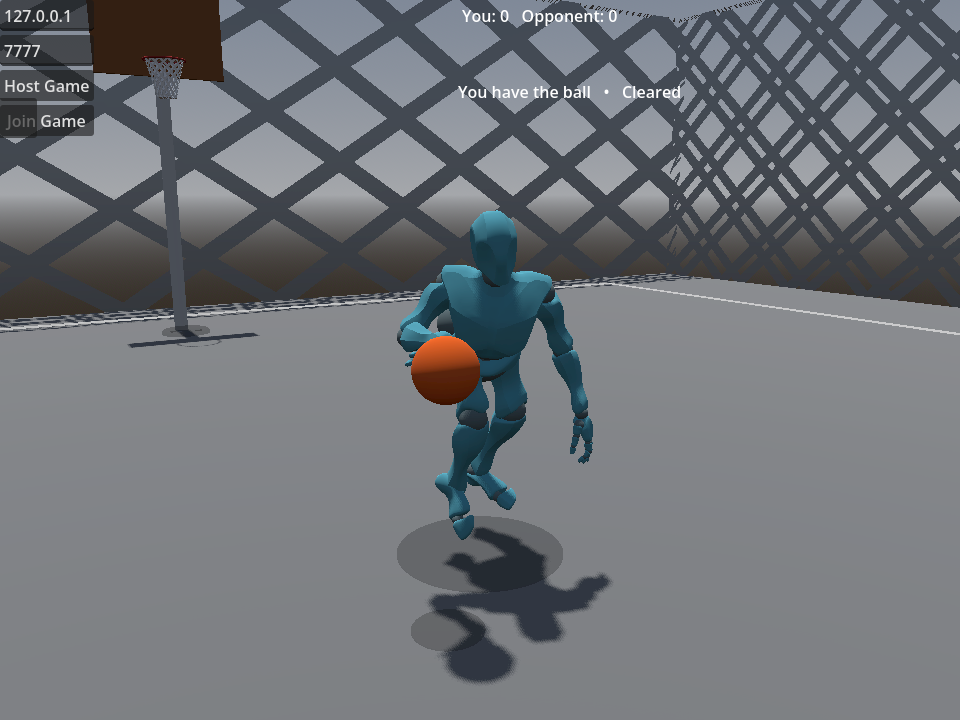
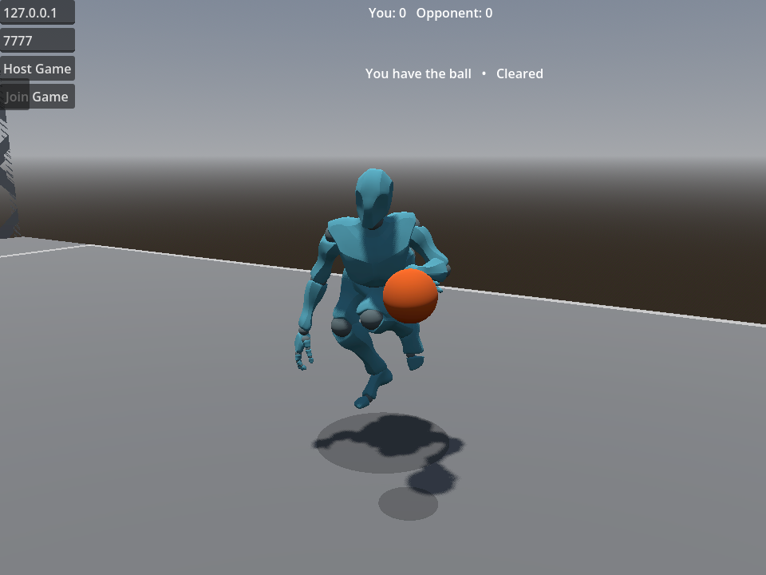
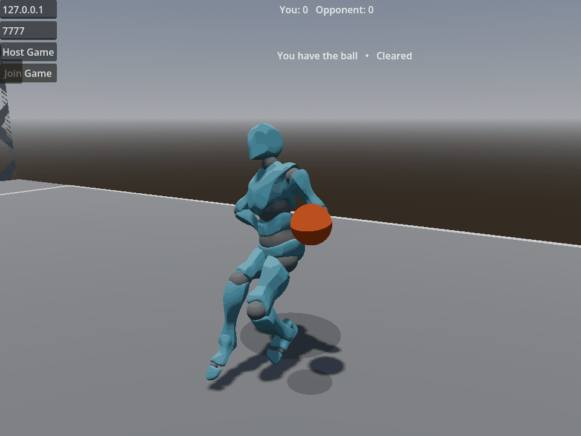

# Held possession after StepBack (#415)

- Date: 2026-10-18
- Related decisions: ADR-0003, ADR-0004, ADR-0008, ADR-0012, ADR-0016, ADR-0027
- Rendered implementation: `882bf2a`; Godot `4.7.1.stable.mono.official.a13da4feb`, .NET 8

This records objective input, state, playback and rendered evidence for #415.
The human retains visual and feel acceptance in #173/#178. This work does not
accept either issue or the other animation findings from the October feel pass.

## Method and reproduction

`HeldPossessionTest.tscn` instances production `Main.tscn`, its actual ball/court,
and two production `Player.tscn` rigs. Physical keyboard events pass through the
shipped InputMap and gesture recognizer. Movement uses the production input
action, not direct velocity or move-machine writes. The trace records input
duration, recognized move, phase, ownership, ball state, HasDribbled, playback
`GetCurrentNode()`, selected blend-point clips, speed and blend value together.

Before presentation changes, `baseline` passed all gameplay premises and `held`
failed its carry playback regression. At tick 551 the spent moving holder had
`Held / holder=1 / HasDribbled=true / speed=6`, while actual playback was
`Locomotion` bound to `locomotion/idle|locomotion/run`. The source-only triage
diagnosis was therefore reproduced through the real scene/input path.

The same fixture now requires actual handed carry playback throughout settled
fresh-Held, spent-Held idle and spent-Held moving windows. Controls exercise:

- Short K (two ticks before release): RetreatDribble, with the dribble retained.
- Sustained K (ten ticks before release): StepBack, every committed phase,
  gather into spent Held, then permitted idle and movement.
- Q plus horizontal input toward the empty hand: BehindTheBack from both hand
  origins. Unmodified live crossover and hesitation both work.
- The same crossover/hesitation gestures after gathering are refused.
- Space after gathering begins JumpShot and actually releases an InFlight ball.
- A real server possession award resets HasDribbled; movement starts a new
  live dribble. The off-ball rig remains in Locomotion.

These are fixed-tick reproduction durations, not newly introduced input settings.
No discrepant gesture or persistent post-award input failure was observed.

## Network proof and scope

`NetHeldPossessionTest` runs production Main, NetworkManager, spawner and RPCs
on two ENet processes. Both processes must pass. Separate `host` and `client`
variants give each controlling role the ball and drive real W/K input. Reliable
test RPCs pace stages and acknowledge observations; they do not seed remote
animation, ownership or move state.

The client observing the host requires the player's presentation tick to equal
the selected coherent world tick. Held ownership/state, move phase, hand, speed,
blend and actual playback are observed together. The server separately asserts
the authoritative Active-entry gather and spent flag. HasDribbled is not in the
presentation envelope: its replicated live convergence is checked separately,
and is not represented as historical metadata. Ownership loss exits carry; a
new award restores legal dribbling. Runtime network motion uses the default
Right hand; both hand bindings are inspected, and the local gesture fixture
exercises both hands.

## Presentation and measured limits

Only neutral Held possession selects `HeldLeft`/`HeldRight`. ReboundGrab and
Pivot retain precedence; every committed phase retains its own animation.
Eligibility reads existing live ownership/state or the remote coherent world
frame. There are no new authority flags, replicated fields or movement rules.

`tools/rebuild_held_clips.gd` preserves the original idle/run root and leg data
and freezes the handed upper-body carry. An offline two-bone solve places the
palm proxy (Index1/Pinky1 midpoint) on the unchanged production ball surface.
This is authored asset data, with no runtime arm solver. The surface point is
0.06 m above the ball centre, on the rear hemisphere of its 0.12 m radius.
This pose choice is subject to human review.

| Measurement | Result |
|---|---:|
| Original root/leg/nonrotation tracks preserved exactly | 44 across four clips |
| Samples per complete endpoint clip | 121 |
| Maximum palm-proxy target error, default rig | < 0.000001 m |
| Arm reach clamping | 0 |
| Rebuilt `held.res` size | 51,555 bytes |

The measurements apply to the default production rig and current ball exports.
They do not establish contact for arbitrary customized proportions or approve
the appearance of the grip. The build is byte reproducible; the final resource
SHA256 is `1b6a946ba3214c4088c57e977e4f5c4413d355114ad9f9fb86f9439f1e3030b7`.

Direct carry transitions use the existing immediate-transition convention.
A trial 0.08 s crossfade queued subsequent moves behind the initial neutral fade
and shortened the observed rebound flourish. The existing exact-duration test
detected this; immediate transitions restore all 30 ticks. Existing neutral
expectations and the explicit Contest graph inventory now include Held.
The squared-up shot's upright control compares its live torso to the other,
stationary off-ball rig's standing torso in skeleton space. The incoming Held
carry leans forward and cannot define the standing reference. The original
22-degree limit remains: normal JumpShot reads 21.27 degrees; substituting
FadeawayActive for its release reads 26.45 degrees and fails. Measuring only
against gravity was insufficient: that intermediate check survived the same
substitution (16.28 degrees). No shot clip or threshold changed.

## Validation and mutation checks

The game build completed without warnings or errors. All 1,230 unit tests passed
with five existing characterization skips. Repository contracts passed 98 tests
with one platform skip. All 389 catalog cases passed across the four shards of
[CI run 39135715728](https://github.com/JoseTomanan/hooper-game/actions/runs/39135715728)
(`c2d9aa8`); the rendered-evidence and crossover-continuity jobs also passed.
After strengthening the standing-reference control (`33047ab`), the local Held
regression and both paired shot geometry cases passed again (three of three).

Disabling Held selection caused both the local regression and the host-holder
network case to fail: the holder actually returned to Locomotion. Restoring
selection restored the host case; CI additionally passed both holder variants. The shot-binding substitution above
also fails the strengthened geometry control while its positive fadeaway control
continues to pass. [Mutation and restored-run excerpts](evidence/0415/mutation-checks.txt)
retain the interventions and measurements. These interventions were reverted; no mutant asset or
production code is retained.

## CI delayed-presentation diagnosis

[Run 39177047482](https://github.com/JoseTomanan/hooper-game/actions/runs/39177047482)
failed the headless crossover continuity case in shard 2, which also failed the
aggregate integration check. The other shards and rendered continuity job passed.
The [selected original trace fields](evidence/0415/ci-delay-failure.json) show
historical Startup on client ticks 95–99 while live hand remained Right and the
last received phase remained Startup. The live Left hand arrived at tick 101,
after historical presentation had already entered Active. The six-tick injector
delay expired without establishing the assertion's required cross-channel overlap.

The diagnostic injector now waits for actual opposite-hand gameplay receipt in
Crossover Active/Recovery as well as the original minimum delay and genuine
underflow. It refills the production buffer, then delivers one unchanged queued
envelope per physics tick. Flushing an arbitrarily long gated queue as one burst
would instead cross the production buffer's 12-tick lag cap and trigger resync.
The continuity bounds and live-ahead-of-Startup assertion remain unchanged.
This is a fixture scheduling repair, with no production networking changes.
[Godot's channel documentation](https://docs.godotengine.org/en/4.7/tutorials/networking/high_level_multiplayer.html#channels)
describes channels as independent streams; their relative arrival must be observed.

The existing two-peer lifecycle test supplies a deterministic receipt gate that
remains closed for six physics ticks after real underflow. Disabling the new gate
check fails with `presentation released before the fixture's receipt gate opened`.
With the gate restored, it requires at least 12 delayed ticks, observed gate wait,
no resync, and the original final-state drain and reconnect proof. It disarms and
clears the completed injector before disconnect so old diagnostic envelopes cannot
contaminate the new peer epoch. All temporary mutation edits were restored.
At `c70ed7a`, the game build passed with no warnings/errors, all 1,230 unit tests
passed with five existing skips, and three repeated lifecycle runs passed with
both peers required. The PR records the final continuity sweep and CI results.

## Rendered evidence

The [manifest](evidence/0415/manifest.json) contains 19 native Windows Mobile/D3D12
PNG observations from `882bf2a`: fresh idle, spent idle, spent moving, all eight
StepBack Recovery ticks, and the first eight Held ticks. Each observation carries
the actual playback/binding, ball state, input duration, camera, physics/render
frame and final modified hand/forearm positions from the same physics frame.
The [launch record](evidence/0415/launch.json) retains the full command line.
The production camera is reframed toward the holder's front/ball side for review.







The GIF uses the sixteen consecutive original transition PNGs at 100 ms per
frame (six times slower than the 60 Hz source). Original PNGs remain alongside
it. Images are evidence for review, not acceptance of pose quality or continuity.

## Reproduce

```powershell
dotnet build "HOOPER GAME.csproj" -p:IncludeIntegrationHarness=true
dotnet test "tests/Hooper.Ball.Tests/Hooper.Ball.Tests.csproj"
python tools/harness_catalog.py run --id held-possession-test-held --godot "$env:GODOT"
python tools/run_network_harness.py held-possession "$env:GODOT" host
python tools/run_network_harness.py held-possession "$env:GODOT" client
python tools/run_held_capture.py --output .godot/held-review-fresh --commit <source-commit>
```

The capture requires a fresh output directory and native rendering. The tool
opens its Windows window hidden. Headless playback proof does not claim rendered
evidence. No editor setup is needed to run the change; visual acceptance remains
with the human's consolidated pass.

## Official API sources

- [Godot 4.7 Animation tracks and typed interpolation](https://docs.godotengine.org/en/4.7/classes/class_animation.html).
- [BlendSpace1D parameters and point positions](https://docs.godotengine.org/en/4.7/classes/class_animationnodeblendspace1d.html).
- [Actual playback state and Travel](https://docs.godotengine.org/en/4.7/classes/class_animationnodestatemachineplayback.html#class-animationnodestatemachineplayback-method-get-current-node).
- [Physical input events through the InputMap](https://docs.godotengine.org/en/4.7/classes/class_input.html#class-input-method-parse-input-event).
- [RPC authority and matching node paths](https://docs.godotengine.org/en/4.7/tutorials/networking/high_level_multiplayer.html#remote-procedure-calls).
- [Final skeleton update signal](https://docs.godotengine.org/en/4.7/classes/class_skeleton3d.html#class-skeleton3d-signal-skeleton-updated).
- [Frame-post-draw readback](https://docs.godotengine.org/en/4.7/classes/class_renderingserver.html#class-renderingserver-signal-frame-post-draw).
