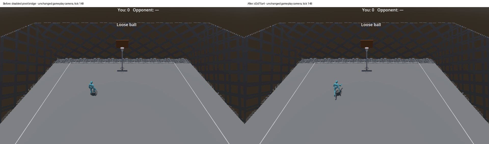
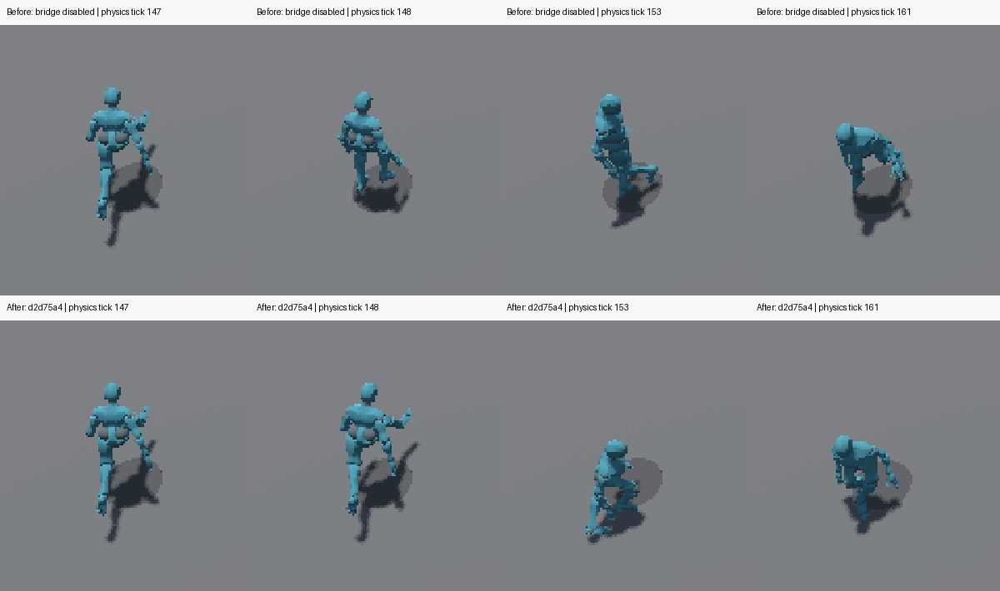

# Planted-pivot pose continuity

- Issue: [#416](https://github.com/JoseTomanan/hooper-game/issues/416)
- Human acceptance: [#184](https://github.com/JoseTomanan/hooper-game/issues/184), with feel in #173
- Baseline: `bc71a6b7bacb02d0773f9c489ac625ad9a73e404`
- Production repair: `d2d75a4`; capture tools: `20ea9c7` plus subsequent proof-only changes
- Engine: Godot 4.7.1 Mono, Godot.NET.Sdk 4.7.1, .NET 8; measured 2026-10-19
- Discipline: source-driven development, diagnosis and independent doubt-driven review

## Reproduction

The real Main scene, NetworkManager, Player scene, AnimationTree and rig reproduce
the abrupt transition under production movement input. The running entry moves
the left/right toe bases approximately **0.716/0.781 m in one physics tick**.
Stationary idle has a smaller entry gap, but neither foot remains fixed in world
space: toe-base excursions during the turn are about 0.242/0.355 m. Left/right
dribble entries and exits also reproduce discontinuities. These are evaluated
bone measurements, not conclusions from transition defaults.

The fixture moves the loose ball away for off-ball idle/run. Dribble fixtures
start a real dribble; left-hand preparation uses a real crossover. Between
measured cycles, an explicit setup reset centers the subject away from court
bounds and the observer. The input driver never writes heading, pivot state,
move phase, hand, or AnimationTree selection. Running entries require at least
5.9 m/s; stationary entries require at most 0.03 m/s. Each case performs three
reversals, or three forward controls. Resetting the position between trials is
not included in continuity measurements.

Owning/host and genuine remote observations include live/display heading,
pivot flags, actual playback node/time, hand, velocity, presentation tick,
history holds/resets and all 65 bones' final world positions and rotations.
`SkeletonUpdated` binds pose and metadata together. GPU frames name their exact
pose sample; rendered trials must bracket both boundaries without gaps greater
than two physics ticks. Repeated evaluations within a tick are reduced to the
last pose, rather than counting intermediate `Advance(0)` results as frames.





[Slowed transition sequence](evidence/0416/run-transition.gif): 6x slower than
60 Hz source time, fixed crop, nearest-neighbour enlargement. The before run
disables only the repair on production commit `d2d75a4`; the after run enables
it. File/sample hashes and exact crop rectangles are in `frame-index.json`.

## Diagnosis and discriminating probes

1. **Endpoint/state mismatch:** a running or handed neutral pose is replaced by
   a distinct pivot pose. Actual evaluated boundary samples establish the gap.
   A diagnostic 50 ms crossfade really enters its fading state, but does not
   repair contact; one toe's excursion increases to approximately 0.706 m.
2. **Clip progress versus latch:** the authored pivot is 0.35 s, while the
   current latch clears after twelve true-flag samples and the last observed
   pivot playback is approximately 0.167 s. Playing its complete authored arc
   is therefore not a reliable way to match this turn's boundaries.
3. **World contact:** freezing the capsule is insufficient. Rotating the rig
   still moves both feet; contact must be constrained after pose evaluation.
4. **Held exit into moving dribble:** the existing intermediate dribble blend
   can take a toe to approximately 1.04 m above the floor while accelerating.
   The unmodified trace reproduces it. A bridge into that transient pose still
   fails, even after the initial pivot entry improves.

The old #273 rest-pose diagnosis was not assumed to have recurred. No shared
animation resource, rest anchor or material track is changed by this repair.

The issue's historical approximately-0.35-second wording predates ADR-0010's
later 900 degrees/s, 0.95-factor amendment. This change preserves the shipped
approximately-0.21-second heading mechanic and its existing harness guards;
it does not restore the superseded tuning or change authoritative movement.

## Repair

`PivotPose` is a per-player SkeletonModifier3D. It starts from the last final
displayed pose, bridges to the appropriate immutable idle/handed stance over
six source-tick intervals, and solves leg contact after blending. It chooses
the foot closer to the body: the slightly lower trailing dribble foot can
be almost a metre behind the hips and is a poor support choice.

The selected toe's world XZ footprint remains fixed from entry. An airborne
incoming run foot lands continuously over four intervals; afterwards its full
world position is fixed on Main's y=0 court plane. This distinction matters:
freezing an airborne toe is not a plant, while instantly putting it on the
floor recreates the discontinuity. Under ADR-0014 tier 2, continuous landing
followed by fixed contact models the real physical constraint. The short
intervals are measured implementation defaults, not accepted feel tuning.

Toe-to-ankle conversion retains the foot's orientation while the existing
two-link solver places the ankle. Minimal pelvis assistance handles an
out-of-reach contact; the other toe is kept above the court. The largest
measured assistance is 0.4765 m during a running entry, versus 0.1280 m idle
and 0.0636/0.0317 m for left/right dribbles. This visible crouch/weight transfer
needs human assessment in #184; the harness does not call it aesthetically
accepted. This implementation assumes the shipped flat court.

Exit blending ends after six intervals. When the destination is an intermediate
ordinary dribble blend, a separate neutral correction interpolates the actual
clip endpoints in skeleton-global bone space until the ordinary tree reaches
an endpoint. This prevents returning through the measured bad accumulation
arc. Protection, post and stance retain their complete evaluated poses.
Committed moves and rebound presentation immediately preempt all pivot work.
There is no global AnimationTree crossfade or extra gameplay commitment.

Buffered remote presentation advances the modifier only when its server source
tick advances. Holds preserve the last pose. Remote epoch/resync changes clear
its cached contact; a local owner never consumes those unrelated reset tokens.
All mesh/pose state stays downstream of heading, collision and ball simulation.

## Official API sources

| Documented contract | Applied here |
|---|---|
| [SkeletonModifier3D processes after AnimationMixer](https://docs.godotengine.org/en/4.7/classes/class_skeletonmodifier3d.html) | Apply pose-only contact without mutating animation resources. |
| [SkeletonUpdated observes final bone results](https://docs.godotengine.org/en/4.7/classes/class_skeleton3d.html#class-skeleton3d-signal-skeleton-updated) | Capture incoming endpoints and synchronize proof with the evaluated pose. |
| [Animation track interpolation](https://docs.godotengine.org/en/4.7/classes/class_animation.html#class-animation-method-rotation-track-interpolate) and [AnimationMixer.GetAnimation](https://docs.godotengine.org/en/4.7/classes/class_animationmixer.html#class-animationmixer-method-get-animation) | Sample immutable authored stances and destination clips; retain rig scale on unkeyed channels. |
| [Quaternion arcs and Slerpni](https://docs.godotengine.org/en/4.7/classes/class_quaternion.html), [Basis rotation/scale](https://docs.godotengine.org/en/4.7/classes/class_basis.html#class-basis-method-orthonormalized), [Node3D coordinate conversion](https://docs.godotengine.org/en/4.7/classes/class_node3d.html#class-node3d-method-to-local) | Reuse temporal hemisphere handling and limb IK; convert fixed world contact into current skeleton space. |
| [Playback travel/position](https://docs.godotengine.org/en/4.7/classes/class_animationnodestatemachineplayback.html), [transition crossfade](https://docs.godotengine.org/en/4.7/classes/class_animationnodestatemachinetransition.html#class-animationnodestatemachinetransition-property-xfade-time) | Observe actual state/time and perform the isolated fade probe. |
| [Input.ActionPress](https://docs.godotengine.org/en/4.7/classes/class_input.html#class-input-method-action-press), [FramePostDraw](https://docs.godotengine.org/en/4.7/classes/class_renderingserver.html#signals) | Drive the real input path and capture GPU output after drawing. |
| [Command-line fixed-fps](https://docs.godotengine.org/en/4.7/tutorials/editor/command_line_tutorial.html) | Native local/CI diagnostic captures use fixed simulation steps; normal remote capture uses real time. Paced CI remote capture explicitly makes no wall-time/network-latency claim. |

One documentation/binding discrepancy was verified against the installed
GodotSharp 4.7.1 XML and compiler: the web NodePath C# example says `GetSubname`,
while the binding exposes `GetSubName`/`GetSubNameCount`. The implementation uses
the installed binding. No framework behavior is inferred from that spelling.

## Proof and results

The complete headless matrix passes eighteen captures and twenty-seven role
reports: idle/run/left/right × flick/held, plus forward control, with three
cycles each. The native D3D12 Mobile renderer also passes that full matrix at
960×540, including genuine real-time remote clients. Two deliberate disabled-
modifier controls complete normally and fail the measured pose-step assertion.
An OpenGL 480×270 paced remote probe also passes, validating CI's capture path.

| Metric | Measured maximum | Regression bound/basis |
|---|---:|---|
| Pivot/tail effector step | 0.3234 m/source tick | 0.39 m: unchanged forward toe-tip control reaches 0.38295 m |
| Bone world rotation | 48.62 degrees/source tick | 50 degrees: unchanged forward control reaches 46.80 degrees |
| Support-foot XZ error | 0.0000061 m | 0.002 m numerical contact tolerance |
| Grounded support height | Numerical zero | Within 0.002 m after four landing intervals |

The first 0.36 m step bound was rejected by the unchanged control: it measured
toe bases but omitted the longer toe tip. It was corrected from baseline data,
not raised to fit a failing repair. The four-interval bridge prototypes failed
later-frame checks even when their boundary samples improved; these failures
motivated the six-interval bridge and closer support-foot choice.

Independent review found two additional bugs and they were repaired before
the production commit. A paired local test resets unrelated remote history
at pivot age four in every cycle: all 312 measured rows/20,280 bone pairs
match the normal run exactly, excluding the allowed epoch/render counter.
A protection pair compares fifteen post-handoff rows/975 bone pairs against
the disabled-modifier control: all positions/quaternion components match
exactly, protection is effective, and the pivot modifier is inactive.
`verify_pivot_context.py` reproduces these comparisons. Review cycle two found
no additional concrete correctness defects.

A final regression test exposed a separate neutral-return defect: the shared
bridge intentionally freezes a crossover's incoming rotation, but a blend
between two advancing neutral clips must advance both endpoints. An opt-in
mode now preserves temporal quaternion signs while following that anchor;
fixed-anchor committed-move bridges retain their existing behavior. The test
failed before the fix, and all 1,232 active unit tests pass afterwards (five
characterization cases remain intentionally skipped). A fresh review found
no concrete defect in this correction.

Compressed before/after traces with SHA-256 hashes, complete matrix summaries,
context results and selected rendered frames are retained in `evidence/0416/`.
The full native matrix summary explicitly labels its pre-review-correction
overlay `bc71a6b7-prototype5`; the representative before/after traces and
images use committed production `d2d75a4`. CI regenerates the complete proof
and publishes full frames/traces for its exact PR revision. Old ignored local
paths in retained manifests are provenance, not portable run commands.

## Re-run and human acceptance

```powershell
python tools/run_pivot_regression.py --godot "$env:GODOT"
python tools/run_pivot_regression.py --godot "$env:GODOT" --rendered
python tools/harness_catalog.py run --id pivot-continuity --godot "$env:GODOT"
```

No editor wiring or import changes are required. For #184, inspect the CI
`pivot-continuity-rendered` artifact and recheck all three existing items on
owning and remote views: idle, running, both dribble hands, released half-turns
and held reversals, including exit while movement stays held. Assess the
landing, crouch/weight transfer, planted read and both boundaries at normal
gameplay distance/speed. The GIF is deliberately slowed and enlarged; use the
full camera frames as the distance reference. Then judge the unchanged heading
mechanic against ADR-0010's current timing, not its superseded 0.35 s value.
Objective #416 proof does not accept or close #184 or #173.
