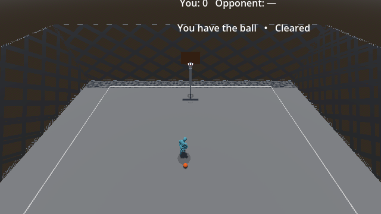

# #417 — Input, behind-body margin and gathered movement repair

Date: 2026-10-21. Implementation/capture revision: `0915c6f`.
Godot `4.7.1.stable.mono.official.a13da4feb`, .NET 8, Windows Mobile/D3D12.
This follows the diagnostic record in `0417-behindtheback-diagnostics.md`;
it does not replace that record or accept feel under #173.

## Authorized behavior

The maintainer explicitly selected **K tap → BehindTheBack to the opposite
hand**, **K hold → StepBack**. The downward stick shares that grammar.
The downward quick window is twelve above-threshold samples; holding through
sample thirteen commits StepBack. The allowance is 200 ms at 60 Hz, versus the
former four samples. Horizontal timing stays four samples. Hold Q through a
K tap/release for RetreatDribble; Q plus horizontal toward the empty hand still
selects BehindTheBack. Magnitude/feel acceptance remains #238/#173.

Spent Held now withholds neutral translation, retaining ordinary finite
deceleration, heading/pivot, shooting and contact. The existing committed
StepBack burst and recovery finish first. The rule also applies after other
gathers because it uses Held + HasDribbled, rather than a separate StepBack
latch. A fresh possession restores movement/dribbling. StepBack now requires
a live dribble: fresh/spent Held attempts are refused, with the existing #253
fresh-Held packet-order allowance retained when the client already dribbled.
Spent Held never receives that allowance. ADR-0003/0008 record these changes.

## Discriminating proof

- Three new recognizer boundary cases failed on the old shared four-sample
  window (StepBack fired on sample five). The focused recognizer suite passed
  after separation; public Sample tests cover 11/12-sample releases, sample-13
  hold, rearm, custom independent windows and unchanged horizontal behavior.
- The production Main/Player real-key fixture failed before the routing and
  movement repair: K selected RetreatDribble and gathered movement reached
  walking speed. The repaired fixture passes two K taps from opposite hands,
  Q+K retreat, old Q+horizontal and horizontal controls, StepBack's full arc
  and Active burst, fresh/spent move refusals, 35 planted movement ticks,
  heading change, a legal shot, possession reset and a new live dribble.
- Production two-process Held fixtures pass for **host-owned and client-owned**
  actors. Both peers observe K transfers from both hands, retained StepBack
  Active speed (10 m/s), spent Held, thirty consecutive zero-speed/fixed-position
  ticks with movement held, then ownership loss/reset and a legal new dribble.
  Remote host geometry uses the matching player/ball presentation tick.
- #253's in-order and out-of-order cradle controls pass. Its former
  no-drive-ever expectation was updated to require refused fresh-Held StepBack,
  continued fresh Held through the old gather window, then successful real
  movement-started dribbling. The real race assertions were retained.
- A prediction-buffer test preserves each tick's translation restriction across
  acknowledgement and a subsequent new possession, retaining raw movement intent.

The exhaustive run exposed one further stale rule assertion:
`SprintTest/gates` expected a spent-Held holder to continue jogging at 6 m/s.
It now requires finite braking from existing speed, settling to zero and a
fixed position with movement and sprint still held. Its fresh-Held drive/sprint
controls remain, and its off-ball control receives an independent starting
velocity. The initial local run had 342/343 single-process passes; all 48 local
multiprocess launches failed through the default Windows WSL Bash shim before
game proof. Hosted CI passed the network cases and all other scenarios; the
corrected sprint assertion is verified separately and by the PR's final CI.

Local command/log records are `.godot/417-red-gather.stdout.log`,
`417-green-held.stdout.log`, `417-net-held-{host,client}.stdout.log` and
`417-final-units.log`. Final exhaustive verification is recorded in the PR.

## Behind-body geometry and rendered evidence

The old path already passed behind the actual posed mesh. An initial
torso-overlap hypothesis was **disproved**, not used as the repair's premise.
CPU skinning of the imported Y Bot vertices using Skin bind poses and the
existing diagnostic trace's final bone rotations reproduced all traced world
bones within 0.00000163 m across fourteen sweep poses. At sampled peaks, the
old full sphere clears the entire mesh's rear plane by 0.0935 m left and
0.1255 m right. This is a half-space measurement, not universal collision proof.
The compact results are [posed-mesh-clearance.json](evidence/0417-repair/posed-mesh-clearance.json).
The frozen reproducer is retained beside that report. It uses ordinary bone
pose getters; the deprecated forced-transform-update API is not required.

The requested extra visual gap changes BehindTheBackSweepDepth from 0.7 to
1.0 m. The baseline remains 0.5 m; sweep duration, hand swap, phase windows
and clips are unchanged. The deepest sampled centre moves from -0.1824 to
-0.4749 m relative to the player root; its forward sphere surface moves from
-0.0624 to -0.3549 m. The new floor requires that surface behind -0.23 m at
least once per transfer. This **additional presentation margin** is deliberately
stronger than merely clearing the measured mesh. It also changes spatial
transit-steal exposure through the existing swept ball position, without new
timing windows or defensive bonuses.

The strengthened shielded-sweep fixture failed at old depth (-0.1824 m) and
passes at new depth (-0.4749 m), then returns to the ordinary hand offset.
Production K-tap fixtures additionally check the full-ball rear margin from
both hands and controlling network roles.

Fresh native captures use the production gameplay camera at 640×360, both
hands, stationary/moving entry, locally and on a real remote client. All eight
captures completed. Local traces include seven sweep samples each; remote
render traces include three/four samples each, all with matching pose, ball
and selected presentation ticks, including the deepest sampled position.
They do not claim every remote tick was drawn. A first 960×540 attempt hit the
image-writer backlog guard and is excluded from proof.

Matched right-origin stationary peak, same camera and input:

| Before | After |
|---|---|
|  |  |

[Capture summary](evidence/0417-repair/capture-summary.json) names the remaining
images and measurements. Each case retains its compressed manifest and raw
trace beside the images. The separate gathered capture retains every Recovery
tick and the first eight Held ticks, plus spent idle and movement-input frames;
its camera is reframed for close inspection, not a gameplay-distance claim.
Its legacy `spent-moving` label now means planted movement **input**.

## Reproduction and sources

Use fresh workspace-local output paths and the process-scope `$env:GODOT`:

```powershell
dotnet build 'HOOPER GAME.csproj' --configuration Debug
dotnet test 'tests/Hooper.Ball.Tests/Hooper.Ball.Tests.csproj' --configuration Debug
python tools/harness_catalog.py run --all --godot "$env:GODOT" --bash 'C:/Program Files/Git/bin/bash.exe'
python tools/run_crossover_capture.py --godot "$env:GODOT" --output .godot/417-new-local --commit 0915c6f --move behindtheback --count 1 --resolution 640x360 --port 23479
python tools/run_crossover_capture.py --godot "$env:GODOT" --output .godot/417-new-remote --commit 0915c6f --move behindtheback --count 1 --remote --resolution 640x360 --port 23479
python tools/run_held_capture.py --godot "$env:GODOT" --output .godot/417-new-held --commit 0915c6f
```

To reconstruct the old corpus's posed-mesh diagnostic (about 131 MB of ignored
intermediate triangle data), run these in order from the repository root:

```powershell
python docs/analysis/evidence/0417-repair/measure-clearance.py
& $env:GODOT --headless --path . --log-file .godot/417-clearance-new.log --script docs/analysis/evidence/0417-repair/reconstruct-mesh.gd
python docs/analysis/evidence/0417-repair/measure-clearance.py
```

Official Godot 4.7 references used for the existing engine seams:
[Input state and event injection](https://docs.godotengine.org/en/4.7/classes/class_input.html#class-input-method-parse-input-event),
[script-driven CharacterBody3D velocity](https://docs.godotengine.org/en/4.7/classes/class_characterbody3d.html#class-characterbody3d-property-velocity),
[RPC authority and channels](https://docs.godotengine.org/en/4.7/tutorials/networking/high_level_multiplayer.html#channels),
[skinned-mesh snapshot requirements](https://docs.godotengine.org/en/4.7/classes/class_meshinstance3d.html#class-meshinstance3d-method-bake-mesh-from-current-skeleton-pose).
Gameplay uses existing engine calls and RPC signatures. Godot does not prescribe
the tap duration, movement rule or ball-sweep depth; those are the recorded
project choices above.

## Limits and remaining judgment

Existing independent ball-snapshot staleness and neutral-only committed replay
remain approximations (ADR-0002/0025). The recorded lock bit prevents today's
possession from rewriting old movement, but does not establish exact historical
agreement under arbitrary possession-correction timing. Contact may depenetrate
a holder; the rule prevents commanded walking, not every possible displacement.
This is not a foul or full pivot-foot travel system.

Geometric separation and inspected screenshots do not accept readability,
telegraph quality or control feel for the human. #173 and #417 remain open;
#178's independent visual debt is unchanged. No editor wiring is required.
